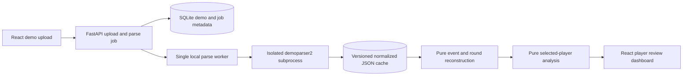

# CS2 Demo Highlight Detection

Status: local parser, normalized cache, event reconstruction, player analysis,
upload/parse API, cached player-analysis API, and React review dashboard are
implemented. Video synchronization and MP4 export from demo timestamps remain
deferred. This document describes current code, not future capability.

## Architecture



## Parser feasibility and source data

`demoparser2==0.42.2` is pinned in `pyproject.toml`. Parser calls are isolated
behind `backend/autoclip/cs2demo/adapter.py`; domain analysis consumes
`ParsedDemo`, not parser-specific frames. The parser checks `PBDEMS2\0` before
loading. The current adapter requests available `player_death`, round
transitions, spawn/team/disconnect, and bomb events. It samples player state at
event ticks and at death tick −1 and +1.

The only local real demo was parser/schema evidence and informed the freeze-end
round-boundary choice; it is not held-out validation or labeled ground truth.
It yielded 10 roster entries, 168 death events, 25 freeze-end events, and 44
official-round-end events. The parser's round event inventory omits canonical
`round_start` and `round_end` for this recording. More detail and event dtypes
are in [DEMO_EVENT_SCHEMA.md](DEMO_EVENT_SCHEMA.md). No precision or recall is
claimed.

## Current data path

1. `POST /api/demos/upload` streams the `.dem` file in 4 MiB blocks, checks the
   extension and `PBDEMS2\0` signature, enforces the configured byte limit,
   computes SHA-256, checks free disk space, and deduplicates by content hash.
2. `POST /api/demos/{demo_id}/parse` stores a parse job. A single queue worker
   validates again and runs parser work in a child process with configurable
   timeout and POSIX address-space limit. Parsing does not block FastAPI's
   event loop. Cancellation terminates the child.
3. Parsed records are normalized into `ParsedDemo` and JSON cached by content
   hash, parser version, and normalized schema version. Reusing the demo with
   the same versions skips parsing.
4. `reconstruct()` maps kills to rounds, joins event SteamIDs to roster IDs,
   rejects warmup, team kills, suicides, world kills, and duplicate events, and
   retains raw event fields for provenance.
5. `analyze_player()` derives supported tags, groups one player's kills within
   a verified round, detects conservative clutch attempts, calculates scores,
   and creates suggested tick windows. It is a deterministic pure analysis
   function after the parsed data is supplied.
6. `GET /api/demos/{demo_id}/analysis/{player_id}` stores results by player and
   detection-settings hash. Filters and sort order are presentation only;
   changing settings reuses parsed events and creates a new analysis key.

## API surface

- `POST /api/demos/upload`: streamed upload, content validation, and dedupe.
- `GET /api/demos/{demo_id}`: upload record without its local filesystem path.
- `POST /api/demos/{demo_id}/parse`, `GET /api/demos/jobs/{job_id}`, and
  `POST /api/demos/jobs/{job_id}/cancel`: parse job lifecycle.
- `GET /api/demos/{demo_id}/match` and `/players`: match metadata and roster
  statistics. ADR/team names are unavailable when the demo does not expose
  them.
- `GET /api/demos/{demo_id}/analysis/{player_id}`: cached player results with
  tag, round, score, sorting, and pagination query parameters.
- `GET /api/demos/{demo_id}/rounds`: round timeline and selected-player kill
  references.
- `GET /api/demos/{demo_id}/analysis/{player_id}/export/{json|csv|timestamps}`:
  all matching highlight metadata, independent of UI page size.
- `GET/PUT /api/settings`: parser and detection controls. Detection setting
  changes recompute analysis from the compatible normalized cache.
- `DELETE /api/demos/{demo_id}`: remove the demo record, uploaded file, and
  content-keyed normalized cache.

## Source map

The following are exact source entry points for independent review:

| Concern | Source reference |
|---|---|
| Parser-independent data model | `backend/autoclip/cs2demo/models.py:12`, `:21` |
| Parser version, signature, events, and state sampling | `backend/autoclip/cs2demo/adapter.py:22`, `:59`, `:87`, `:195`, `:285`, `:328` |
| Content/version cache | `backend/autoclip/cs2demo/cache.py:25`, `:46`, `:80` |
| Parse queue and cancellation | `backend/autoclip/cs2demo/queue.py:26` |
| Normalized round and kill reconstruction | `backend/autoclip/cs2demo/reconstruct.py:67`, `:165`, `:296`, `:341` |
| Pure selected-player analysis and tags | `backend/autoclip/cs2demo/analyze.py:26`, `:139`, `:197`, `:497` |
| Transparent score formula | `backend/autoclip/cs2demo/scoring.py:9` |
| Resource/detection settings | `backend/autoclip/config.py:85`, `backend/autoclip/cs2demo/detection_models.py:10`, `backend/autoclip/api/settings.py:39`, `:44` |
| Upload, job, match, roster, analysis, timeline, export, deletion API | `backend/autoclip/api/demos.py:39`, `:128`, `:139`, `:147`, `:158`, `:170`, `:194`, `:224`, `:304`, `:389` |
| Analysis persistence | `backend/autoclip/db/schema.py:160`, `backend/autoclip/db/store.py:174`, `:188` |
| SQLite demo and parse-job migrations | `backend/autoclip/db/schema.py:114`, `:137` |
| CLI inspect/players/analyze | `backend/autoclip/cli.py:711`, `:779` |
| React demo upload and review | `frontend/src/pages/DemoReview.tsx:14`, `:301` |
| Existing application navigation | `frontend/src/App.tsx:33`, `frontend/src/main.tsx:19` |

## Domain models and cache

- `DemoPlayer`: session ID, optional SteamID64, optional name/team.
- `ParsedDemo`: content hash, parser/schema versions, header, roster, event
  names, normalized event dictionaries, sampled player states, optional tick
  rate, and warnings.
- `RoundWindow`: stable local round key, active start, end/completeness,
  available boundary event IDs, optional outcome tick/winner evidence.
- `KillEvent`: stable event ID, tick/round, attacker/victim/assister IDs and
  teams, weapon, verified event flags, plus raw source event.
- `Highlight`: IDs, tags, score and breakdown, round/tick/time fields, kill
  details, source event IDs, clutch evidence, and data-quality warnings.

The normalized cache is JSON written atomically. Cache compatibility depends
on content SHA-256, parser version, and schema version. SQLite stores demo and
parse-job metadata plus compact per-player analysis results, not the bulk event
stream.

## Identity and event attribution

SteamID64 is the only safe cross-event identity. Roster display names do not
drive attribution. Events with missing attacker or victim SteamIDs remain
unattributed and cannot become a selected player's kill. If a roster player
has no SteamID64, current analysis returns an explicit error for selecting that
player rather than risk joining duplicate names. Name changes do not affect
SteamID matching; player reconnect/session behavior still needs additional
recordings to validate.

An event is a valid enemy kill only when attacker and victim are both known,
are different players, have known teams, and those teams differ. Duplicate
source rows are deduplicated using tick, identities, and weapon. Warmup state is
checked from sampled state rows; when missing, round-association gaps can also
exclude the event. Raw events retain unknowns for future diagnostics.

## Round reconstruction and grouping

The current source preference is `round_freeze_end`, then `round_start`,
`round_prestart`, and `round_poststart`. When available, freeze-end is the
active boundary for kills. End tick comes from the latest available
`round_end`/`round_officially_ended` event before the next start, or is bounded
by the tick before the next active start. An unclosed final round stays
incomplete.

Round winner is only inferred if score state is present at both active start
and outcome, the same teams remain assigned to the same team numbers, and one
and only one score increases by one. Otherwise it is unknown. This deliberately
leaves some bomb outcomes unknown, especially around halftime, incomplete event
states, or score-field gaps.

Every valid kill in one round is currently grouped into one selected-player
play. This prevents splitting a real multi-kill into ignored one-kill pieces
when tick rate or inter-kill time is unknown. It can merge unrelated sequences
in a long round or classify a round total as a rapid sequence; grouping needs
real footage labels and a separately validated interval policy. No group spans
round IDs. Clutch overlaps merge into that round play. A clutch-only attempt can
also produce a candidate without a kill.

## Supported classifications

| Classification | Current evidence rule | Status |
|---|---|---|
| 2K–5K | Distinct known enemy victims attributed to selected player in round | Implemented; grouped by round |
| Ace | Five distinct victims exactly match five alive opponents at round start, with 5v5 alive-state proof | Conservative implementation; real validation absent |
| Opening kill | Earliest valid enemy kill in round | Implemented |
| Round-winning elimination | 5v5 start, complete alive snapshot after kill, opponents all dead, teammate survives | Implemented conservatively |
| Headshot | Parser `headshot` true | Implemented where field exists |
| Headshot streak | Configurable consecutive selected kills in grouped play are headshots | Implemented |
| Wallbang | `penetrated > 0` | Implemented where field exists |
| No-scope | Parser `noscope` true | Implemented where field exists |
| Through smoke | Parser `thrusmoke` true | Implemented where field exists |
| Blind kill | Parser `attackerblind` true | Implemented where field exists |
| Knife kill | Weapon begins with `knife` | Implemented; aliases need more schema validation |
| AWP multi-kill | At least two AWP kills in grouped play | Implemented |
| Fast multi-kill | Kill span divided by verified rate/override ≤ configured seconds | Implemented only when rate is known |
| 1vN clutch | Complete roster state shows selected player alone vs N alive enemies | Implemented strictly by default |
| Clutch outcome | Selected death, all enemies dead with survivor, or verified score outcome | Implemented conservatively |
| Ninja defuse | No reliable unnoticed-defuse signal | Not implemented |
| Bomb plant/defuse highlight | Bomb events parsed but not promoted to highlight | Not implemented |
| Low HP, economy, movement/aim quality | Not normalized or validated | Not implemented |

Clutch state is sampled at event ticks plus death-adjacent ticks rather than
continuously every game tick. Strict mode requires all roster IDs to have alive
and team state at the snapshot. A player disconnected or missing from state can
make the attempt unclassifiable. Outcomes `unknown` are retained when a proven
attempt has no valid result evidence.

## Scoring and candidate generation

Tags generate a candidate. Score only ranks candidates; there is no top-N
discard limit. Each score is the sum of its breakdown components:

| Component | Points |
|---|---:|
| 2K / 3K / 4K / 5K | 15 / 25 / 35 / 45 |
| 1v1 / 1v2 / 1v3 / 1v4 / 1v5 clutch | 10 / 20 / 30 / 40 / 50 |
| Won clutch | +20 |
| Each headshot | +2 |
| Headshot streak | +5 |
| Wallbang / through-smoke / blind kill | +5 each |
| No-scope | +8 |
| Knife kill | +6 |
| AWP multi-kill | +5 |
| Opening kill | +5 |
| Round-winning elimination | +8 |
| Fast multi-kill | +10 |

Weights live in `DetectionSettings.score_weights` in
`backend/autoclip/cs2demo/detection_models.py`; `scoring.py` adds only weights
for tags/evidence present. Scores are explicit heuristics, not calibrated skill
or quality probabilities.

## Suggested clip timing

Default pre-roll is 4 seconds, post-roll 5 seconds, won-clutch post-roll 8
seconds, and minimum duration 8 seconds. With a known tick rate, windows expand
to the minimum duration within round bounds; a round too short to satisfy it
gets a warning. Tick rate is not currently exposed by the adapter; seconds and
second-based padding are unavailable unless configured via override. Ticks
remain canonical, clip windows clamp to round boundaries, and a maximum-
duration conflict is warned about rather than truncating the supported event
span. There is no video-time synchronization or MP4 export for demos.

## Configuration and CLI

`cs2_demo` configuration includes upload and parser limits, optional tick-rate
override, pre/post-roll, minimum/maximum suggested duration, fast multi-kill
threshold, headshot streak length, strict clutch-state mode, and default visible
tags. Changes recompute analysis without reparsing. The local CLI provides:

```bash
autoclip cs2demo inspect match.dem
autoclip cs2demo players match.dem
autoclip cs2demo analyze match.dem --steamid 7656119XXXXXXXXXX
```

The Python analysis entry point is `autoclip.cs2demo.analyze.analyze_player`
and accepts a stable `steamid:<id>` roster identity plus `DetectionSettings`.

## Validation status and limits

- The local 10-player, 25-round, 168-death-row recording had a 1,669,612-byte
  normalized cache. With the expanded demo present, `parse_cached` took 1.638
  seconds; cache reload median was 9.1 ms and selected-player analysis median
  was 11.4 ms over ten runs. Decompressing the provided fixture plus parsing
  took 2.35 seconds total. These measurements are for this recording and
  machine; API/HTTP overhead and peak memory were not measured.
- A separate synthetic 10-player/25-round analysis measured a 4.9 ms median.
  This is only a microbenchmark and not a user-facing throughput guarantee.
- Synthetic tests cover round-scoped 2K–5K, verified/unverified ace, teamkill,
  suicide/world/warmup rejection, duplicate events, event tags, clutch
  won/lost/unknown, missing state, score provenance, and deterministic IDs.
- The available local demo was parsed and aggregate event/round assignment was
  inspected. It was not manually labeled, so no accuracy, precision, or recall
  is reported.
- That same demo was used during development to choose round-boundary
  behavior. There is no independent held-out recording; manually verified
  selected-player kills and TP/FP/FN counts are all unavailable (zero labels).
- No evaluation fixture independently verifies all real-match kills, multi-
  kills, or clutches. The observed parser output is not ground truth.
- Player switching API, React review, filters, round timeline, settings, and
  JSON/CSV/timestamp exports are implemented and tested against synthetic API
  fixtures. Real-demo/video synchronization and MP4 export remain deferred.
- Set `AUTOCLIP_TEST_DEMO_PATH` to an uncompressed local CS2 `.dem` to enable
  additional parser/cache/event-provenance invariants. These checks still do
  not replace manually labeled gameplay ground truth.
