# AutoClip CS2 Demo-to-MP4 Rendering Feasibility

**Status:** Analysis only; no application behavior was changed.
**Inspected:** 2026-11-22.
**Scope:** Render already-selected AutoClip highlights by playing the original CS2 demo in CS2 and capturing that rendered playback. The existing detector remains the authority for highlight selection and bounds.

## 1. Executive summary

AutoClip can produce gameplay video from a `.dem` without a separate gameplay recording, but the renderer must run CS2 on a supported Windows or Linux host. The existing Apple Silicon macOS host is suitable for AutoClip’s UI, parsing, highlight detection, job persistence, and final exports; it is not a supported CS2 rendering host. Valve’s Steam listing currently lists Windows and SteamOS/Linux requirements, and CS2VideoGenerator itself supports Windows/Linux rather than macOS. [Steam CS2 system requirements](https://store.steampowered.com/app/730), [CS2VideoGenerator README](https://github.com/CS2OpenDev/CS2VideoGenerator/blob/6e04580bd2ff03b41f82ace0e4bc64c60d556d38/README.md)

The strongest current fit is **CS2VideoGenerator (CSVG), version 0.10.1**, run in a dedicated Windows worker process on the RTX 4070 Ti PC. CSVG explicitly defines itself as a capture executor: its compilation input accepts demos, raw start/end ticks, a SteamID field, and a spectator target name; its runner loads a demo, captures clips, and batches clips from the same demo in ascending tick order. It has an in-engine `startmovie`/FFmpeg path that captures game audio and a separate OBS path. That separation is exactly the desired boundary: AutoClip supplies highlight metadata; the renderer does not select highlights. [CSVG README and compilation contract](https://github.com/CS2OpenDev/CS2VideoGenerator/blob/6e04580bd2ff03b41f82ace0e4bc64c60d556d38/README.md), [CSVG compilation runner](https://github.com/CS2OpenDev/CS2VideoGenerator/blob/6e04580bd2ff03b41f82ace0e4bc64c60d556d38/src/Cs2VideoGenerator.Core/Cs2CompilationRunner.cs)

There are two significant feasibility risks that prevent declaring the feature proven:

1. **Player POV is not reliably keyed by SteamID in CSVG 0.10.1 by default.** The clip schema carries `PlayerSteamId` as metadata but also requires `PlayerNameToSpectate`; CSVG documents that its normal path uses `spec_player` by exact display name. Its opt-in SteamID path is marked experimental and known unreliable on some game builds. A wrong player POV is a failed render. This must be solved or explicitly rejected at runtime before production integration. [CSVG limitations](https://github.com/CS2OpenDev/CS2VideoGenerator/blob/6e04580bd2ff03b41f82ace0e4bc64c60d556d38/README.md#known-limitations), [CSVG roadmap](https://github.com/CS2OpenDev/CS2VideoGenerator/blob/6e04580bd2ff03b41f82ace0e4bc64c60d556d38/docs/ROADMAP.md)
2. **CS2 rendering automation depends on an in-game plugin and CS2 changes frequently.** CSVG temporarily modifies `gameinfo.gi`, the game plugin/search path, and configuration, then launches CS2 in `-insecure` mode. It has backup/restore routines, but a crash can still require recovery. CS Demo Manager has a mature implementation but also documents real version-specific plugin and tick-action failures. [CSVG installation and safety notes](https://github.com/CS2OpenDev/CS2VideoGenerator/blob/6e04580bd2ff03b41f82ace0e4bc64c60d556d38/README.md#important-how-csvg-modifies-your-cs2-installation), [CSDM issue #1458](https://github.com/akiver/cs-demo-manager/issues/1458)

**Recommendation:** build no renderer until a Windows proof of concept produces one manually checked MP4 from the actual AutoClip result. Use CSVG 0.10.1+ as the first candidate, defaulting to its documented in-engine capture provider rather than its experimental present hook or HLAE. Keep the worker behind a narrow replaceable adapter. Start rendering only when the user submits an existing highlight ID; do not reparse, regroup, score, or alter the highlight.

The result can be automatic after initial setup, while the Windows PC is online, Steam is logged in, and a graphical user session is available. Current evidence does **not** establish fully headless operation, Windows-service operation, rendering without a logged-in desktop, or operation without a monitor. “No manual interaction” is achievable as an unattended job in a preconfigured interactive session; “headless server rendering” is not established.

## 2. Research method and evidence labels

The AutoClip code and current local cache were inspected directly. The candidate repositories were shallow-cloned read-only under `/tmp` and inspected at these source revisions:

| Project | Inspected revision | Upstream state observed |
|---|---|---|
| CS2VideoGenerator | [`6e04580`](https://github.com/CS2OpenDev/CS2VideoGenerator/commit/6e04580bd2ff03b41f82ace0e4bc64c60d556d38), tag `v0.10.1`, 2026-10-30 | Release page showed v0.10.1 as latest on 2026-11-22. |
| CS Demo Manager | [`950459e`](https://github.com/akiver/cs-demo-manager/commit/950459e333b8563094f2e1f4d7e41948396792e3), tag `v3.21.1`, 2026-11-18 | Active source tree and CLI/video docs. |
| cs2-highlights-maker | [`a60695a`](https://github.com/pykvarz/cs2-highlights-maker/commit/a60695ab634dc618d5c77abfbeef0941917714c7), 2026-09-25 | No release tags or root `LICENSE` file in inspected checkout. |
| cs2-dem-renderer | [`02b09ff`](https://github.com/reka-ai/cs2-dem-renderer/commit/02b09ffeaf7c3a0685a3e3e44ad6b2519f682c22), 2026-06-25 | README says its Linux plugin branch targets CS2 1.41.6.5. |

The reports distinguish:

- **Verified from AutoClip source/cache:** directly read implementation or current local persisted data.
- **Verified from candidate source/docs:** implementation or project documentation says the capability exists. This does not mean it was run in this audit.
- **Reported:** issue/report from a project user; useful as a failure case, not a benchmark or universal property.
- **Unknown/unverified:** no tested evidence in the inspected sources. These require the proof of concept.

No demo was uploaded or sent externally in this investigation. The cached database was opened read-only. No CS2 process was launched; no rendering, Steam configuration, install, or demo analysis was run.

## 3. Current AutoClip implementation

### 3.1 What is implemented

AutoClip currently provides local demo upload, validation, hashing/deduplication, isolated `demoparser2` parsing, versioned normalized JSON caching, player selection by SteamID, deterministic selected-player detection, cached analysis persistence, event evidence, and a React review page. The detector emits ticks and nullable derived seconds; it explicitly does not claim those ticks are synchronized to a video recording. The UI says this directly.

The existing general video pipeline accepts video sources, stores jobs/clips, uses FFmpeg, and produces 9:16, 1:1, or 16:9 outputs. The vertical “fit” path uses a blurred, darkened background behind the full frame. The code does not contain a CS2 Focus preset. The MP4 demo-render feature, rendering job type, worker protocol, generated-video preview, and highlight-to-render link are not implemented.

The routes in `backend/autoclip/api/demos.py` are upload, parse/status/cancel, match, roster, rounds, per-player analysis, JSON/CSV/timestamp export, and delete. There is no render route. The clip export route in `backend/autoclip/api/clips.py` requires an existing persisted video `Clip`, its source, and a `Job`; the demo analysis records are not those clip rows.

### 3.2 Actual cached proof-of-concept record

The current read-only SQLite and normalized cache show one parsed FACEIT demo, map `de_mirage`, parser `demoparser2 0.42.2`, schema 3, 161 `player_death` events, 6,130 player-state observations, and a cached roster entry for ThakurShaaab. The parse warnings say tick rate was not exposed and the canonical `round_start`/`round_end` pair is incomplete.

The cached analysis for `steamid:76561198865074734` contains 10 highlights. Its Round 15 highlight is stored as:

```json
{
  "player_id": "steamid:76561198865074734",
  "round_number": 15,
  "tags": ["2K", "multi_kill", "clutch_won", "clutch_1v1", "round_winning_elimination"],
  "score": 53,
  "start_tick": 89511,
  "end_tick": 90345,
  "kill_count": 2,
  "kills": [
    {"tick": 89511, "attacker_name": "ThakurShaaab", "victim_name": "Buug_11", "weapon": "deagle"},
    {"tick": 90345, "attacker_name": "ThakurShaaab", "victim_name": "Keepup-_", "weapon": "deagle"}
  ],
  "clutch": {"start_tick": 90104, "end_tick": 90345, "opponents_alive": 1, "outcome": "won", "bomb_state": "planted"}
}
```

This is verified AutoClip event analysis, not independent visual ground truth. The actual MP4 has not been rendered or checked. Its `start_seconds` and `end_seconds` are null because the parsed tick rate is missing. The detector therefore did not add its seconds-based pre/post-roll (see `analyze.py:_build_highlight`). Passing the existing raw start/end ticks to a renderer does not require a tick-to-seconds conversion; converting requested seconds of extra padding does. Do not silently assume `tick / 64` in the renderer.

### 3.3 AutoClip source map and change boundary

| Existing component | Source and important symbols | Current responsibility | Integration impact | Must remain unchanged? | Proposed minimal extension later |
|---|---|---|---|---|---|
| Demo API | `backend/autoclip/api/demos.py`: `upload_demo` (38), `parse_uploaded_demo` (128), `get_player_analysis` (224), `export_player_analysis` (304) | Upload/parse/read-only analysis/export endpoints. No MP4 route. | Add separate render job/status/cancel/result endpoints only after POC. | **Yes:** current upload and analysis contracts. | Add request endpoint taking `demo_id`, selected player ID, and existing `highlight_id`; validate it maps to a stored analysis. |
| Demo queue | `backend/autoclip/cs2demo/queue.py`: `DemoParseQueue`, `_run_one` | Single background parse queue, progress/status/cancel, retry interrupted parsing. | Rendering is long-running and remote; do not put CS2 work into parser queue. | **Yes.** | Add a distinct render scheduler/job adapter. |
| Parser adapter | `backend/autoclip/cs2demo/adapter.py`: `DemoSource`, `parse_demo`, `parse_isolated`, `validate_demo_file` | `demoparser2` behind normalized models; parser subprocess with timeout/memory guard. | Worker should receive original demo plus hash; it need not parse highlights. | **Yes.** | Worker performs only required demo/player playback lookup, not highlight discovery. |
| Parsed cache | `backend/autoclip/cs2demo/cache.py`: `cache_path`, `parse_cached`, `require_cached` | Content-hash/parser/schema-version cache. | Reuse the original cached data and transfer the demo only on cache miss at worker. | **Yes.** | Store worker-side demo by SHA-256 to dedupe network transfer. |
| Normalized match | `backend/autoclip/cs2demo/models.py`: `ParsedDemo`, `DemoPlayer` | Match header, roster, raw normalized events/state, optional tick rate and warnings. | Carries identity/ticks; no render objects or path synchronization. | **Yes.** | Use SteamID and current/history names only as renderer targeting inputs. |
| Reconstruction | `backend/autoclip/cs2demo/reconstruct.py`: `reconstruct`, `KillEvent`, `RoundWindow` | Deterministic round/player/event reconstruction. | Input source for renderable highlight event evidence. | **Yes.** | No duplicate reconstructor in worker. |
| Highlight model and detector | `backend/autoclip/cs2demo/detection_models.py`: `Highlight`; `analyze.py`: `analyze_player`, `_build_highlight`; `scoring.py` | Tags, scores, event IDs, bounds, warnings. | Renderer must consume the stored candidate without changing its values. | **Absolutely.** | Render request references `highlight_id`, stored bounds, tags and events. Keep render padding separately recorded. |
| SQLite store | `backend/autoclip/db/schema.py` migrations v3–v5; `backend/autoclip/db/store.py`: `put_demo_analysis`, `get_demo_analysis` | Demo metadata/jobs and JSON analysis keyed by demo/player/settings. No render-job table. | Need additive schema migration for render jobs/artifacts only. | **Yes, existing tables/records.** | New tables reference demo/player/highlight ID and hash; no migration changing detector output. |
| React demo review | `frontend/src/pages/DemoReview.tsx`: upload, player selection, results, `HighlightCard` | Roster and evidence expansion; currently no video preview/action. | Add render controls/status after backend POC. | **Yes, current analysis UI.** | Add “Generate video” to a highlight and render preview when validated artifact is available. |
| Existing video job queue | `backend/autoclip/jobs/queue.py`; `backend/autoclip/pipeline/runner.py` | Transcript/video pipeline queue and SSE progress/cancel. | Worker runs on Windows and is not a local pipeline stage. | **Yes.** | Keep separate render-job state and progress adapter. |
| Existing media/DB paths | `backend/autoclip/paths.py` | `~/.autoclip/media`, `work`, `exports`, SQLite. | Can store render metadata and imported MP4 under existing local root. | **Yes.** | Use hash/job-scoped directories; clean worker and Mac temporary files by job lifecycle. |
| Existing FFmpeg export | `backend/autoclip/pipeline/export.py`: `ExportRequest`, `build_video_filtergraph`, `export_clip`; `backend/autoclip/api/clips.py:188` | Captions, crop/fit, audio normalization, hardware encoder selection, exports/download. | A rendered MP4 could become the source for this pipeline after a bridge is designed. It is not directly callable from a `Highlight` today. | **Yes: presets and behavior.** | Add a thin render-artifact-to-export bridge; don't reimplement the presets in the worker. |

Relevant local references: `api/demos.py:38–118, 223–300, 303–386`; `adapter.py:59–84, 87–192, 195–245`; `cache.py:22–83`; `models.py:11–31`; `reconstruct.py:67–161`; `analyze.py:26–120, 497–610`; `detection_models.py:64–89`; `db/schema.py:114–172`; `db/store.py:174–200`; `DemoReview.tsx:203–328`; `pipeline/export.py:20–28, 87–165, 221–328`; `api/clips.py:188–260`; `app.py:47–75`.

## 4. Architecture: rendering an existing highlight

```mermaid
flowchart LR
  A[AutoClip on Mac<br/>existing demo cache and analysis] --> B[Render request<br/>demo hash + highlight ID + exact ticks + SteamID]
  B --> C[Authenticated LAN worker link]
  C --> D[Windows worker<br/>interactive logged-in desktop session]
  D --> E[CS2 renderer adapter<br/>CSVG first candidate]
  E --> F[CS2 loads demo and seeks by tick]
  F --> G[Target POV set and confirmed]
  G --> H[Game frames + game audio captured]
  H --> I[H.264/AAC MP4 + diagnostics]
  I --> J[Worker verifies media and returns artifact]
  J --> K[AutoClip local render artifact/job]
  K --> L[Existing preview/review integration]
  L --> M[Existing FFmpeg export presets]
```



The rendering contract is not allowed to accept a detector/scorer strategy. It should accept a *specific already-persisted candidate*:

```text
RenderRequest:
  request_id, demo_id, demo_sha256, original_demo (or staged hash reference)
  highlight_id, player_id (SteamID64), player display-name-at-event
  round_id/number, source_start_tick, source_end_tick
  optional render_start_tick/render_end_tick (separate, explicitly derived)
  1920x1080, 60 fps, MP4/H.264, game audio on, capture preset ID

RenderResult:
  request_id, status, output hash/path, duration, resolution, fps, codecs
  audio-present flag, requested/observed capture ticks, selected POV evidence
  game/plugin/renderer versions, warnings, phase timings, bounded logs
```

Raw demo ticks are the correct seeking unit. Do not convert highlight bounds to seconds and back. Keep `source_start_tick` / `source_end_tick` immutable and separately report any render padding. The current POC highlight has no parser-derived tick rate, so seconds-based pads must not be guessed. The first POC should either use the exact bounds as a plumbing test (expect little context) or establish a verified tick-rate source and explicitly wider render bounds before judging whether the resulting play is complete.

The renderer can read a normalized roster or use its own minimal player-slot lookup to turn SteamID into a POV target. It cannot run a second highlight detector or change the supplied event list, tags, score, or source interval. If its game plugin only supports exact display-name targeting, the worker must map the selected SteamID to a unique in-demo name at the interval, record the mapping, and fail closed on ambiguity. Experimental SteamID targeting cannot be accepted as reliable without repeatable footage tests.

## 5. How demo playback capture works

The `.dem` is played by CS2. The renderer sends game commands to load the demo, seek to a tick, set spectator mode/target, set capture settings, start capture at a scheduled tick, and stop at an end tick. The renderer captures actual frames produced by the Source 2 client and game audio. FFmpeg then encodes/muxes a standard video container. This is not a parser-to-image reconstruction and not an original live-match POV recording; it is a replay rendered by the installed game version.

### 5.1 Loading and compatibility

- AutoClip accepts only uncompressed Source 2 demos with `PBDEMS2\0`; `.dem.zst` upload is rejected with an extraction message (`adapter.py:59–76`; `api/demos.py:71–85`). The Windows worker should receive the exact same original `.dem`, verify the SHA-256, and not accept paths supplied by the browser.
- CS2 generally loads demo files through its game client using its demo playback command. CSVG’s compilation carries a local path and its runner calls `LoadDemoAsync`; CSDM’s CLI accepts a demo path and its game-control layer writes a per-demo action JSON. The POC must confirm absolute staged paths work on the chosen worker and that FACEIT recordings are accepted by the installed CS2 build.
- CS2 demo playback can depend on the game build that recorded the demo. CSDM documents installing an older compatible CS2 depot for older demos. A renderer must report build/demo mismatch and fail or require a matching supported game version; it must not silently claim a clip is valid. [CSDM playback compatibility](https://cs-demo-manager.com/docs/guides/playback)
- Steam must be installed and signed in sufficiently for the renderer’s launch method. CSDM and `cs2-dem-renderer` explicitly check a running Steam client; CSVG doctor checks Steam installations and users. Steam credentials must never enter AutoClip or the worker API.
- Loading `.dem.zst` is outside the existing upload contract; the file used by AutoClip is already decompressed. No network download or external demo service is needed.

### 5.2 Tick seek and timing

- CSVG exposes `LoadDemoAsync`, `SetDemoTickAsync`, and `PlayTickRangeAsync`. Its modern plugin has arrival-verified seek acknowledgements when a required capability is present; the acknowledgement returns the tick observed by the engine, rather than merely echoing the requested tick. This is stronger than firing a console command and assuming the seek completed.
- CSDM schedules `demo_gototick` and other actions in a JSON file read by its CS2 plugin. Source comments document workarounds: setup commands need lead time and action ticks near tick zero can be skipped. CSDM clamps actions to tick 96 in the inspected source.
- CSVG docs also note the first ticks after `demo_gototick 0` can swallow scheduled commands; the default start clamp is 96. It reports a warning if a clip begins earlier. This is an engine limitation that can affect very early-round clip bounds.
- Playback needs a stabilization interval after the seek before the first captured frame. CSVG’s clip coordinator orders seek, POV/options, then capture; its docs discuss the post-seek tint and seek/setup timing. The POC must inspect the actual first frames. Add configurable lead-in via *render* bounds and wait-for-arrival/stability, not by rewriting AutoClip’s highlight bounds.
- No renderer should silently use `tick / 64` to construct seconds for this match. AutoClip’s cache has `tick_rate: null`; exact tick control can still be tested. For time-based clip padding, require a verified demo tick rate or explicit user setting and annotate it as estimated.

### 5.3 POV and HUD

- CS2 spectator commands have used either `spec_player <slot/name>` or a Steam/account ID lock command. CSDM builds player records with SteamID and game slot, then schedules `spec_mode 1` before `spec_player <slot>`; its CLI has `--focus-player <SteamID>`.
- CSVG’s `PlayerSteamId` is metadata; normal targeting is exact display-name `spec_player`. Its experimental capability attempts `spec_lock_to_accountid` with name fallback and is documented as unreliable. This is the most important architectural mismatch against AutoClip’s stable SteamID identity.
- The selected player must remain focused through the relevant life; test what CS2 shows when the player dies, disconnects, changes display name, transitions to spectator, or the clip crosses a round boundary. The renderer must return POV-target telemetry if available; otherwise an image-based/operator validation is required for the proof of concept.
- Keep a visible gameplay HUD and death notices for review. Renderer presets that hide the HUD or show only death notices are not equivalent to full gameplay. Confirm normal HUD, kill feed, selected first-person view, and game audio in the result.

### 5.4 Video and audio capture

**CSVG InEngine (recommended initial path):** CS2’s `host_framerate` plus `startmovie` outputs frames at requested capture cadence. The project streams/deletes frame files while FFmpeg encodes, and captures an engine WAV for audio. Its in-engine guide says its source code/docs were validated on a real CS2 build (2000879) for 1080p60 with audio, but this audit did not run it. It reports a reference machine measurement around 70 fps capture for 60 fps output at 1080p (about 1.16x game-time throughput); that is not a measurement on the RTX 4070 Ti. At 1080p60 its TGA mode can demand roughly 500 MB/s of frame writes before its stream-and-delete path catches up, so fast NVMe and free-space monitoring matter. [CSVG in-engine capture notes](https://github.com/CS2OpenDev/CS2VideoGenerator/blob/6e04580bd2ff03b41f82ace0e4bc64c60d556d38/docs/in-engine-capture.md)

**CSVG InEngineHooked:** A Windows-only experimental DXGI present hook streams RGBA frames to FFmpeg and avoids the normal `startmovie` frame-file readback. Its docs report about 2.7x real time on the project’s reference setup. It is a later performance option, not the first production dependency: it adds a more invasive graphics hook, is experimental, and was not run here.

**CSVG OBS:** OBS screen-records the game window over obs-websocket and can launch OBS automatically. This is a normal desktop capture and therefore depends on real-time frame pacing and OBS audio configuration; it is not tick-exact offline capture. It is a fallback when in-engine capture breaks, not the strongest path for deterministic frames.

**CS Demo Manager:** its docs describe CS2 producing raw `.tga` frames and `.wav`, then FFmpeg/VirtualDub encoding them; HLAE+FFmpeg can stream output directly to video. CS2 manager supports HLAE on Windows, but Linux HLAE is unsupported. It exposes 1080p/60 settings and a SteamID focus option. [CSDM video architecture/OS matrix](https://cs-demo-manager.com/docs/guides/video), [CSDM CLI video options](https://cs-demo-manager.com/docs/cli#generate-videos)

**cs2-highlights-maker:** uses HLAE `mirv_streams`, records an `audio.wav`, and combines it with video through FFmpeg. It is Windows-only in its stated requirements and runs with `-insecure`. Its root project license was absent in the inspected checkout.

**cs2-dem-renderer:** writes MP4 from streamed TGA frames, but its FFmpeg argument list is video-only; no audio input/mux is present. Its Linux implementation sets VAAPI/Radeon-specific environment and uses Linux process/display assumptions. It therefore fails the Windows RTX 4070 Ti + synchronized game audio target without material work.

## 6. Open-source comparison matrix

Legend: **Yes** = source/docs show capability; **Partial** = constrained/conditional; **No** = not implemented or incompatible with this requirement; **Unknown** = not established by source or this audit.

| Criterion | CS2VideoGenerator 0.10.1 | CS Demo Manager 3.21.1 | cs2-highlights-maker | cs2-dem-renderer |
|---|---|---|---|---|
| Current CS2 compatibility | Partial: release/recent source, build handshake; real demo evidence documented for build 2000879, not current worker build | Yes/partial: active CS2 app; plugin updates required; real plugin regressions have been reported | Partial: README claims CS2; current-build proof not inspected | No/partial: README plugin build targets CS2 1.41.6.5; source dated June 2026 |
| Automated demo load | Yes, CLI/Core | Yes, GUI and CLI | Yes, command-line workflow | Yes, `steam -applaunch` |
| Exact tick seeking | Yes; tick API and arrival-ack capability | Yes; action JSON commands at ticks | Yes; actions file with tick commands | Partial; own parser produces spawn/death ticks, not arbitrary requested range |
| SteamID POV | Partial; default exact player name, experimental unreliable SteamID route | Yes/partial; CLI SteamID resolves player slot, still needs visual verification | Partial; parser maps SteamID to slot and builds POV actions | Partial; parses SteamID but command uses game user ID/slot |
| Video capture | Yes: in-engine, hooked experimental, OBS | Yes: game `startmovie` or HLAE | Yes: HLAE `mirv_streams` | Yes: CS2 `startmovie` TGA |
| Game audio | Yes: engine WAV or OBS audio | Yes: WAV/HLAE capture | Yes: WAV then mux | **No in inspected FFmpeg pipeline** |
| MP4 | Yes, FFmpeg | Yes, FFmpeg/VirtualDub | Yes, FFmpeg | Yes, FFmpeg HEVC/VAAPI |
| Windows | Yes | Yes | Yes | Partial: README says “minimal modifications”; source is Linux-oriented |
| Linux | Yes, normal in-engine/OBS; hooked variant Windows-only | Yes, but HLAE unavailable; CSDM docs list CS2+FFmpeg support | No | Yes, intended platform |
| macOS CS2 | No | No | No | No |
| CLI/API for external tool | CLI and .NET Core API; compilation JSON is a good boundary | CLI exists, but jobs use CSDM’s shared desktop-app queue/DB; no standalone rendering service API | CLI; recorder function is Python-callable but coupled to its own model | CLI and directory worker; no request API |
| Batch same demo | Yes, loads once and orders captures by tick | Queue supports multiple videos/sequences; game lifecycle per queued video may relaunch | Sequence batch supported by one recorder call | Directory worker batches demos; many per-player-round outputs |
| Headless/service proven | No; offscreen/unfocused documented, but not no desktop/session | No | No | No; requires Steam and an X display/session |
| GPU encoding | FFmpeg configurable; NVENC depends on FFmpeg build/provider config; capture still GPU-bound | FFmpeg codec selectable; NVENC option documented in CLI examples | FFmpeg configurable; README uses x264 CRF default | VAAPI HEVC path, Linux/Radeon-oriented, not RTX Windows out of box |
| License | MIT at v0.10.1; v0.10.0 and older GPL-3.0-only; preserve notices | MIT | Unknown for repository code: no root license file. Bundled CSDM plugin NOTICE says MIT | MIT; check third-party notices |
| Maintenance | New project/recent v0.10.1; small ecosystem | Mature, ~2k stars/active commits through 2026-11-18 | New/small; one star, no release tags in inspected clone | Very new; one initial commit observed |
| Detector replacement risk | Low: explicit capture-executor boundary | Medium: event/sequence generation and analysis are integrated, but explicit ticks/config can be passed | High: parser/detector/recorder coupled; could only reuse recorder carefully | High: parser owns per-player-round generation |
| Integration fit for AutoClip | **Best first candidate** if POV and game safety gates pass | Strong fallback/reference, but not a clean standalone worker API | Not recommended for production dependency | Not recommended for required Windows+audio exact-highlight workflow |
| Reliability evidence | Source tests, compatibility checks, project real-demo docs; not independently verified here | Mature app and fixes; issue tracker demonstrates tick/POV/plugin edge cases | README claims; no independent validation | Source adds hang detection but build/audio/target interval gaps remain |

## 7. Candidate findings

### 7.1 CS2VideoGenerator (preferred POC target)

Source entry points include `Cs2CompilationRunner.RunAsync`, `LoadDemoAsync`, `CaptureClipAsync`, `ClipCaptureCoordinator`, `Cs2CompilationClip`, the engine session (`SetDemoTickAsync`, `SetSpectatorTargetAsync`), capture provider implementations, `FfmpegService`, and the native gRPC plugin. The `.NET` CLI accepts `csvg generate --file compilation.json`; the Core library can be consumed without using the CLI. The compilation runner groups clips by demo, opens each demo once, orders those clips by ascending start tick, records them sequentially, and returns per-clip results. Concatenation is optional.

The input contract already aligns with existing AutoClip data (`DemoFilePath`, `StartTick`, `EndTick`, `PlayerSteamId`, `PlayerNameToSpectate`, capture settings). It does not score or choose clips. The worker adapter can map one AutoClip highlight to one CSVG compilation clip and use the exact stored ticks. This is a better seam than embedding a second analyzer.

Operational requirements: CS2; Steam install/user; FFmpeg; Windows or Linux; bundled game plugin; enough local storage for frames; matching supported game build. CSVG temporarily changes `gameinfo.gi`, installs the plugin/search path and modifies configs/user settings, starts with `-insecure -allow_third_party_software`, then attempts restoration. It includes `doctor`, game/plugin compatibility reports, backup/restore/cleanup commands, capability negotiation, and structured per-clip results. The stock CLI has no REST worker server or completion callback requirement; a small Windows agent can invoke the CLI or host its .NET Core API and expose a separate authenticated AutoClip worker protocol.

Licensing: v0.10.1 (released 2026-10-31) changed project license to MIT. The release page explicitly says versions through v0.10.0 remain GPL-3.0-only. Pin to a reviewed MIT release, retain third-party notices, and do not treat old packages as MIT. [Release history](https://github.com/CS2OpenDev/CS2VideoGenerator/releases)

Main limitation: per the current README, the normal `spec_player` target is by exact player name. The model’s SteamID does not drive the camera. Experimental `spec_lock_to_accountid`/SteamID targeting exists but is marked unreliable and off by default. Until that is fixed and verifiable, a requested SteamID must be resolved to a unique correct name at the event tick, and the output must be reviewed. SteamID-selected POV is not yet a safe acceptance assumption.

### 7.2 CS Demo Manager

CS Demo Manager is the most mature reference and a viable manual fallback. Its Video guide explains the actual flow: launch CS2, run a demo, execute tick-scheduled commands; collect raw frames/audio; encode using FFmpeg/VirtualDub, or use HLAE+FFmpeg streaming. Its CLI supports an explicit tick interval, a player-event mode, `--focus-player <SteamID>`, a JSON config, `--record-audio`, dimensions/FPS, codec controls, and queue list/pause/resume. `csdm watch` can launch the game with a demo, an initial tick, a focus player, and tick-executed commands.

However, video jobs join CS Demo Manager’s shared desktop queue, and docs state the demo should already be analyzed and present in its database. A direct programmatic API for AutoClip is not the public integration surface. A wrapper around `csdm video` is possible but brings CSDM’s app lifecycle/database assumptions and its full executable/plugin distribution into the worker. Extracting the exact tick action generator and capture routines under MIT may be legally and technically possible, but becomes a maintained fork of game-control code. The CLI is useful for comparing the POC and as a fallback when a user already operates CSDM.

The active repo includes real edge-case fixes and reports: player POV could be wrong on some builds, action ticks can be swallowed after seeking, and issue #1458 reports a plugin break on one August 2026 game update. The latter was marked closed/need-repro in the issue tracker; it is evidence of plugin-version fragility, not a claim that current release is broken. [POV issue #1238](https://github.com/akiver/cs-demo-manager/issues/1238), [video performance report #1343](https://github.com/akiver/cs-demo-manager/issues/1343), [plugin issue #1458](https://github.com/akiver/cs-demo-manager/issues/1458)

Platform caveat: the docs list Windows and Linux for CS2+FFmpeg, but HLAE (needed for some overlays/death-notice options and its streaming path) is Windows-only; macOS is not supported for CS2 playback. [CSDM compatibility](https://cs-demo-manager.com/docs/guides/video)

### 7.3 cs2-highlights-maker

This is a compact Windows CLI joining a parser/detector, event grouping, HLAE recording, and postprocess. Its recording subsystem is implemented under `src/highlights/recording/`: `recorder.record` stages the demo, creates per-sequence actions, installs a server plugin, launches HLAE, verifies MP4/audio files, then removes temporary playback files. `sequences.build_actions_file` writes explicit tick actions, `spec_mode`, `spec_player`, and `mirv_streams` capture setup. The record call accepts its own `DemoData` and `Sequence` values; using it without its detector would still require an adapter supplying that data and correct slot mapping.

The project does not expose a stable external renderer service contract; it automatically installs HLAE/FFmpeg from releases; it claims roughly real-time processing; and the default HLAE route injects `AfxHookSource2.dll`. Its overall CLI owns analysis and top-N selection, which AutoClip must not adopt. The repo clone had no root `LICENSE` file; its bundled CSDM `server.dll` carries a separate MIT NOTICE. Do not vendor or copy the project’s Python source until the author supplies a license. It is a useful source-inspection reference, not the preferred dependency.

### 7.4 cs2-dem-renderer (additional candidate)

This Go/Linux project parses demos for every player’s spawn/death interval and key-input metadata, generates action JSON, launches CS2 with Steam, then streams TGA frames into FFmpeg. It offers a directory-worker mode. Its current renderer creates per-player-alive-round videos, not a targeted AutoClip highlight job; its source uses `spec_player` from a user ID/slot. It outputs per-round Parquet data and uses a fixed 64-tick assumption to convert timing, which is not suitable for this cached match’s currently unknown timing without verification.

The inspected `encode.go` FFmpeg argv carries video but no audio input, so the output does not meet synchronized game-audio acceptance. It uses Linux-specific paths, `pgrep`/`pkill`/`journalctl`, X/Steam session assumptions, and VAAPI/Radeon environment variables. README says its Windows version needs modifications and its plugin branch targets 1.41.6.5. It is not an appropriate Windows RTX/audio/exact-tick renderer, though its hang detection and streamed-frame implementation are useful design references. MIT license; respect `THIRD_PARTY_LICENSES`.

## 8. Platform, unattended execution, and hardware

| Environment | Finding |
|---|---|
| Apple Silicon macOS | Keep as AutoClip host only. Steam currently lists Windows and SteamOS/Linux, not macOS, for CS2. Neither CSVG nor CSDM supports CS2 playback on macOS. Wine/CrossOver/Game Porting Toolkit is not a validated renderer platform and is not a foundation for an automated worker. |
| Windows RTX 4070 Ti PC | Best target. CSVG supports Windows; CSDM/HLAE and the candidate Python renderer target Windows. RTX 4070 Ti can encode with NVENC if the chosen FFmpeg build exposes the required encoder. This machine has not been benchmarked here. |
| Linux alternative | CS2 and CSVG’s standard InEngine path are supported. CSDM’s non-HLAE path is documented. HLAE is not natively supported by its own FAQ. Linux can be a fallback only after testing the exact GPU/display/audio stack; not needed while the Windows PC is available. |

**Unattended is not the same as headless.** The existing tools automate CS2 commands and capture. They do not demonstrate that CS2 can be run as a Windows service in Session 0, without a logged-in user, or with no active display device. CSVG says its offline in-engine mode works with an unfocused/offscreen game window; that is evidence about window focus, not proof of boot-without-desktop operation. OBS needs a working game capture/audio input in the desktop session. A virtual display may work in principle but is unknown and must not be advertised until tested.

Practical setup to validate: Windows starts, an interactive user has logged in, Steam is authenticated, the AutoClip worker auto-starts in that user’s session, CS2 and FFmpeg are installed, and the worker launches capture without user action. Test with the display locked, then without a physical monitor, as separate acceptance experiments. If either fails, require the PC to remain logged into a desktop; do not solve this by running the renderer as a Windows service.

### Performance evidence and limits

- CSVG’s docs report a reference machine (32-core, NVMe, NVIDIA) at about 70 output frames/s for a 60 fps 1080p in-engine recording (roughly 1.16x game time); its experimental Windows present-hook path reports 162 fps (2.7x) at 1080p60. This is upstream measurement, not independently reproduced and not measured on the 4070 Ti.
- CSVG’s `startmovie` TGA method documents approximately 8.3 MB/frame at 1080p RGBA and about 500 MB/s for 60 fps. Its consumer streams/deletes frames to control accumulated storage; slow FFmpeg/disk creates staging backlog.
- OBS is real-time: 15 seconds of game requires at least 15 seconds plus setup; slow frame delivery may drop frames. Offline capture is usually faster than real time only when the GPU/CPU/disk pipeline sustains it.
- The 4070 Ti’s NVENC can reduce H.264 encode cost; it does not bypass CS2 simulation, graphics readback, seeking, filesystem IO, or a slow tick action. Compare NVENC and software H.264 in the POC.
- Initial demo transfer is one-time per SHA-256. For the cached ~219 MiB example, ideal transfer time is roughly 18 s at 100 Mbit/s or 2 s at 1 Gbit/s, before protocol overhead. This is a calculated lower bound, not a measured LAN rate. Hash-based worker cache makes subsequent selected-player/render jobs avoid retransferring the same demo.
- No local measurements exist for startup, demo load, tick seek, capture setup, GPU/CPU/RAM, throughput, output size, worker transfer, or this 4070 Ti. Record them in Phase 1; do not claim the reference rate as expected machine performance.

## 9. MacBook-to-Windows worker design

Keep the existing AutoClip binding localhost-only by default. An opt-in worker pairing must be explicit and limited to the trusted LAN. The simplest supportable topology is one Windows worker with an authenticated local HTTP(S) API bound to its LAN interface, with Windows Firewall allowing only the Mac’s private IP. AutoClip on the Mac connects to the worker’s pinned certificate/worker identity. Do not expose an unauthenticated game-control or file API to the Internet.

Pairing should generate a per-worker random secret or client certificate once; store it in OS credential storage on each host, not in the match/detection JSON. Require a one-time displayed pairing code and explicit registration. Use request-scoped job IDs, a demo SHA-256, a worker version/capability handshake, TLS, bounded upload chunks, a maximum body size, allowlisted file destinations, and a per-job output manifest. Protect against path traversal and shell injection by using structured subprocess arguments, never a shell command string.

Protocol outline:

1. Worker reports `worker_id`, OS, CS2 build, renderer version, supported capture/POV/audio capabilities, available disk and online session state.
2. Mac enqueues an immutable render request referencing the persisted demo and highlight IDs; idempotency key is `demo_hash + highlight_id + renderer_config_hash`.
3. Mac transfers the source `.dem` in bounded chunks if the worker lacks a matching hash. Worker verifies size, `PBDEMS2\0`, and SHA-256 before CS2 sees it.
4. Worker accepts one game job at a time. It launches CS2 under the interactive user session, sends progress/events (`validate`, `stage_demo`, `launch`, `load`, `seek`, `set_pov`, `capture`, `encode`, `validate_output`, `upload`), and writes only within its task directory.
5. Mac can cancel a job; worker stops the current renderer/FFmpeg process, restores modified CS2 files, marks partial output, and never publishes it as a validated clip.
6. Worker uploads MP4 plus a small JSON result and diagnostics. Mac verifies checksum and media metadata, then links the file to the same AutoClip highlight ID.
7. Lease timeout marks the job interrupted. Retry only that highlight after process cleanup; do not duplicate a completed output with a second filename.

Limit worker concurrency to one CS2 process. Keep temporary demo and frame data on local NVMe. Upload the final MP4 rather than raw frames or audio. Transfer only the minimum metadata and no Steam credentials.

## 10. Security, Steam, FACEIT, and licensing

CSVG and HLAE both interact with CS2 at the process/plugin level. CSVG modifies the installation temporarily and launches with `-insecure`; HLAE’s own README calls itself technically a hack and warns users not to join VAC-protected servers. Valve’s Trusted Mode FAQ says CS2 restricts third-party process injection and that unsigned DLL injection launches insecure mode, which cannot join VAC-secure servers; Steam’s VAC guidance says injected/game-modifying software creates account risk in protected contexts. Treat the upstream warning as operationally significant; do not claim an absolute safety guarantee. [Valve Trusted Mode FAQ](https://help.steampowered.com/en/faqs/view/09A0-4879-4353-EF95), [HLAE README](https://github.com/advancedfx/advancedfx/blob/main/README.md), [Steam VAC FAQ](https://help.steampowered.com/en/faqs/view/571A-97DA-70E9-FF74)

Operational policy for the future worker:

- Use render-only offline demo playback. Never join public, VAC-secured, GOTV, FACEIT, or other protected matches while the CS2 process is instrumented or the installation is modified.
- Do not run HLAE/CSVG at the same time as a FACEIT match or FACEIT Anti-Cheat session. HLAE’s FAQ lists FACEIT AC among software known to cause hook problems; this is a compatibility/security boundary, not a claim that offline rendering violates FACEIT rules. FACEIT’s own policy prohibits software used to gain unfair match advantage; it does not establish renderer approval. [HLAE FAQ](https://github.com/advancedfx/advancedfx/wiki/FAQ), [FACEIT definition of cheating](https://support.faceit.com/hc/en-us/articles/360015788779-What-is-deemed-to-be-a-cheat)
- A separate Windows user or dedicated rendering machine reduces accidental mixing with regular play, but it does not by itself make injection risk disappear. A separate Steam account is optional isolation, not a guarantee or a technical requirement; do not store its password in AutoClip.
- Verify restoration after successful, failed, cancelled, and forcibly terminated jobs. The recovery page should explain how to use CSVG’s restore/doctor and Steam file verification before returning the PC to normal online play.
- Pin exact renderer versions and hashes; download packages from the official release source only after review; retain their license/third-party notices. The `cs2-highlights-maker` repo’s missing root license prevents assuming its source can be copied or redistributed.
- Treat demos as untrusted. Validate the signature, size/hash and supported demo version. Run game control as a least-privileged worker user, isolate per-job paths, reject untrusted command strings, restrict network interfaces, limit logs/output size, and kill child process trees on cancellation.

## 11. Output validation and failure handling

FFprobe can verify container, duration, width/height, frame rate, codecs, and presence of an audio stream. That is **metadata validation only**. It cannot prove the correct player, round, kill, HUD, or audio sync was captured.

| Failure | Detection | Recovery/action | User-visible result |
|---|---|---|---|
| Worker offline / no interactive session | heartbeat, worker capabilities, session state | leave job queued; no demo transfer until ready | “Rendering PC is offline or not signed into its desktop.” |
| Steam/CS2/FFmpeg missing | preflight doctor, executable paths, encoder list | stop before staging; setup instructions | name the missing dependency |
| Demo unsupported or playback rejects it | demo header/build check and engine load status; timeout as fallback | preserve demo, attach compatibility diagnostics; no infinite retry | demo/game-build incompatibility with remedy |
| Seek timeout or wrong observed tick | arrival-verified engine tick, bounds check | close/reload demo once, then fail | requested and observed ticks |
| Player missing/ambiguous | worker roster lookup by SteamID and in-demo name at event tick; duplicate-name check | fail closed; do not use arbitrary `spec_player` fallback | selected SteamID could not be targeted uniquely |
| Wrong POV or POV changes | plugin telemetry if available; sampled frames/manual POC inspection | fail, retain evidence, fix POV targeting before batch release | video rejected as wrong perspective |
| Capture command swallowed/never stops | progress deadline, CSVG capture state, output growth | immediate stop/kill process tree; restore game; retry single highlight once | capture command was not confirmed |
| Black/frozen/dropped frames | ffprobe frame count, sampled frame statistics/perceptual duplicates, playback check | reject output and preserve logs | failed video quality validation |
| Audio missing/desynchronized | ffprobe audio stream/duration; audio-video onset/ending checks; manual POC | reject if audio required; keep raw WAV only in private job folder | missing or out-of-sync game audio |
| GPU/FFmpeg error / low disk | process exit, stderr tail, free-space threshold, backlog | clean partials, retry with software encoding only if configured and approved | clear encoder/disk error |
| Game crash / update incompatibility | exit code, plugin log/handshake, game build | restore backups, stop queue, prompt update/recovery | distinguish CS2 crash from renderer failure |
| Upload/network interruption | chunk hashes, heartbeat/lease, result SHA-256 | resumable transfer; idempotent finalization | upload retry without rerender when artifact remains on worker |

The first release should not auto-accept a render until the user or developer confirms one sampled clip visually and aurally. Later automated checks can catch metadata failures, black frames, frame duplication, audio absence and tick mismatch, but POV identity and gameplay relevance need stronger engine telemetry or a validated visual check.

## 12. Existing export integration

The existing `pipeline/export.py` has output aspect ratios 9:16 (1080×1920), 1:1 (1080×1080), and 16:9 (1920×1080). It uses tracked crop segments, or a “fit whole frame over blurred copy” chain; the selected path can burn caption styles and normalize audio. Its encoder helper checks whether NVENC works. This audit found no named “CS2 Focus” preset. (References: `pipeline/export.py:27–29, 87–165, 178–218`; settings in `config.py:139–148`.)

Do not duplicate vertical encoding in the Windows renderer. First produce a horizontal 16:9 MP4 with game audio. After return, integrate it into the current local preview/review and call the existing export/filtergraph path via a small adapter. Since the current generic export route requires `Clip` + `Source` + `Job`, the next design review should decide between (a) additive rendered-video/highlight tables and an export adapter that reuses `pipeline.export`, or (b) a deliberate bridge into existing video clip records. Do not mutate detector highlights into ordinary video clips or create fake `demoparser` analysis records. Preserve existing FFmpeg presets and add “CS2 Focus” only in a separately approved task after verifying it does not already exist.

## 13. Recommended proof of concept (design only; not run)

Use the already parsed local demo, SHA-256 `5babddf8a13e21c6b207a690e8759aa58ad214acff91039b4cda0ea7e2dafb49`, and existing highlight `Round 15 / ThakurShaaab / steamid:76561198865074734 / 2K + 1v1 clutch won / 53 points / stored ticks 89511–90345`. Verified event evidence includes two Deagle kills at 89511 and 90345 and clutch state beginning 90104 with a planted bomb. The underlying demo/cache exists locally; the POC must transfer only to the user-owned Windows worker, never to a third party.

Do not send the SteamID as the only camera field to CSVG and assume correctness. The experiment should:

1. Generate one CSVG compilation request from the stored candidate without changing its tags, score, kill events, or ticks.
2. Resolve the SteamID to the target display name valid in that demo; verify it is unique. For this record the cached name is `ThakurShaaab`. Record the targeting mode/name in result evidence.
3. Use exact ticks initially to test load/seek/capture plumbing. Because seconds padding is unavailable, do not label the output as complete context until a verified rate/extra tick range is established.
4. Capture 1920×1080, 60fps, visible HUD/death notice, audio on, MP4/H.264 (AAC if renderer produces/muxes AAC), sequential single worker. Run CSVG `doctor`, collect renderer/game build numbers, capture logs and phase timings.
5. Verify the observed seek tick, requested target, target POV, round context and both expected Deagle eliminations by manually watching the MP4; also inspect audio, freeze/black frames and first/last frames. Run FFprobe and record output metadata, but do not treat that as proof of game correctness.
6. Repeat the same request once to test repeatability and record per-clip duration, startup/load/seek time, average FPS, CPU/GPU/RAM, NVMe throughput/backlog, output size, audio stream/duration/sync and recovery cleanup.

POC passes only when it produces a playable, visually correct target POV with both events, a complete enough view window, synchronized game audio, no black/frozen frames, repeatable boundaries, a restorable CS2 install, and useful logs—without user interaction after submitting the render request. If CSVG cannot target and confirm this player reliably, stop and test CSDM’s SteamID-to-slot route as a second POC before designing the worker API.

## 14. Biggest risks

1. **POV identity:** CSVG currently defaults to display-name targeting, while AutoClip’s stable key is SteamID. Name changes/duplicates or failed spectator commands can yield a plausible but wrong MP4.
2. **Game/plugin update fragility:** CS2 builds can invalidate plugin hooks, action schedules, capture commands, or demo compatibility. Upstream projects have concrete reports of version-specific failures.
3. **Game safety and recoverability:** plugin/HLAE hooks modify or instrument CS2. Insecure mode and restoration reduce some risks but do not make it safe to join protected servers or remove account-policy concerns.
4. **Tick lead-in and engine state:** current highlight bounds are raw ticks; this example has no tick rate and therefore no detector-applied seconds padding. A rendered clip can cut right at event endpoints or miss setup/context.
5. **Audio/video/render quality:** frame capture can be slow or backlogged; OBS can drop frames; audio can be absent or misaligned; a playable container does not prove the expected kills appear.

## 15. Feasibility conclusion

The MacBook + Windows RTX 4070 Ti architecture is technically plausible and local-only. The user can submit a job and receive MP4s without opening CS2 manually after one-time worker setup, provided the Windows host is online in a logged-in desktop session. **No existing candidate proves all acceptance criteria on the actual target hardware/build and cached FACEIT demo today.** CSVG is the best modular starting point, subject to the POV blocker and a real visual/audio POC. If that fails, evaluate CSDM’s CLI/recording mechanisms without using its own detector, while checking whether its shared queue/DB requirements are acceptable. No implementation is approved or included in this report.
