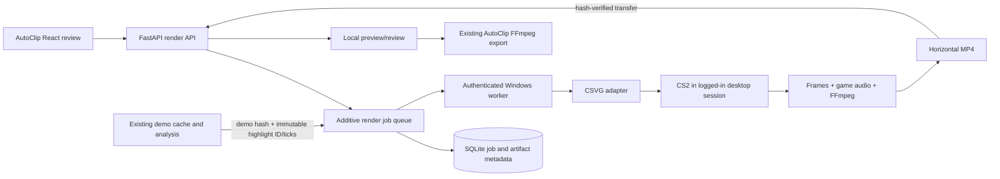

# CS2 Demo Rendering — Implementation Roadmap

**Status:** design proposal only. No renderer or AutoClip application code is implemented by this document.

## Recommended architecture

Keep the Mac as the AutoClip host and add one optional, separately installed Windows rendering worker. AutoClip remains authoritative for demo parsing, player identity, event reconstruction, highlight selection, scoring, and source tick boundaries. The worker receives immutable render requests and returns video artifacts plus diagnostics. The first backend adapter should target CS2VideoGenerator (CSVG) behind a replaceable interface, subject to a successful target-player POV proof of concept.



Do not put render execution in the demo parser queue. Parsing and detection have different resource needs, cancellation behavior, failure modes, and hardware locality. Do not introduce cloud queues, Redis, Kubernetes, or another database.

## Integration boundary and existing modules

The existing detector should remain unchanged: `backend/autoclip/cs2demo/adapter.py`, `cache.py`, `models.py`, `reconstruct.py`, `analyze.py`, and `detection_models.py`. The upload, analysis, and JSON/CSV/timestamp export APIs in `backend/autoclip/api/demos.py` remain the existing detector-facing API. The cached `Highlight` is the source of truth. The renderer must not derive classifications, scores, event boundaries, or player selection from the demo again.

Likely additive integration points, to be verified against the then-current checkout before implementation:

| Additive area | Proposed responsibility |
|---|---|
| `backend/autoclip/rendering/models.py` | Validated request/result/status contracts, independent of CSVG types |
| `backend/autoclip/rendering/adapter.py` | Replaceable `DemoRenderer` protocol and backend selection |
| `backend/autoclip/rendering/worker_client.py` | Authenticated submission, status, cancellation, upload/download |
| `backend/autoclip/rendering/queue.py` | Bounded jobs, retries, cancellation, progress and artifact finalization |
| `backend/autoclip/api/renders.py` | Render job endpoints; never alter existing demo routes’ semantics |
| SQLite migration | Separate render jobs/artifacts linked by IDs/hashes; no copied event corpus |
| Windows worker package | CSVG orchestration, demo staging, preflight, logs, cleanup |
| React review integration | Generate one/selected, progress, retry/cancel, preview/download |
| Existing `pipeline/export.py` adapter | Reuse existing horizontal/vertical FFmpeg paths on returned MP4 |

Do not modify `cs2demo/` detection modules, OCR/video detection, existing export filtergraphs/presets, or parser cache format merely to introduce rendering. Do not synthesize `Clip`/`Source`/`Job` domain rows just to force a demo highlight into an existing export endpoint; design a minimal artifact bridge that reuses the exporter without changing detector data.

## Proposed data contracts

These are design-level fields, not implemented schemas. Names should be aligned with repository conventions before coding.

### Render request

```json
{
  "render_job_id": "opaque-idempotency-key",
  "demo_id": "73fa424473544f40",
  "demo_sha256": "5babddf8a13e21c6b207a690e8759aa58ad214acff91039b4cda0ea7e2dafb49",
  "highlight_id": "existing-stable-highlight-id",
  "player_id": "steamid:76561198865074734",
  "player_steamid64": "76561198865074734",
  "player_demo_name": "ThakurShaaab",
  "start_tick": 89511,
  "end_tick": 90345,
  "capture": {"width": 1920, "height": 1080, "fps": 60, "audio": true, "container": "mp4"},
  "preset": "horizontal_gameplay",
  "output_name": "round-15-highlight.mp4"
}
```

The JSON is illustrative. Use the existing candidate’s stable ID if present; otherwise add an immutable analysis-result identifier in the rendering integration layer without changing highlight detection. The request needs the demo hash and the original exact ticks so the worker can reject wrong or stale demo content. Name is only a playback-camera hint when the backend needs it; SteamID remains the identity key. Fail closed on ambiguous target resolution. Any additional lead-in/out must be represented as a render-only window and must never overwrite stored highlight bounds. Do not multiply ticks by 64: the cached target demo reports a missing tick rate.

### Render result

Return job ID, backend/version, terminal or current status, phase progress, output artifact ID, SHA-256, bytes, duration, dimensions, average/nominal frame rate, video/audio codec and stream presence, requested and observed capture boundaries if backend can report them, warnings, structured diagnostics/log references, and actionable failure code/message. Distinguish requested ticks from capture boundaries; a backend that cannot report observed tick should say “unverified”, not imply precision.

## API and worker design

Keep AutoClip’s current default host binding local-only. A Windows worker connection should be explicitly configured and opt-in. Pair the worker with AutoClip using a one-time setup secret exchanged out-of-band, then use a revocable per-worker credential or mutual TLS. Restrict the worker firewall to the Mac’s trusted LAN address, bind only to the private interface, reject unauthenticated requests, validate every path/field, and never place Steam credentials in the request. Do not expose a public relay.

Recommended endpoints (illustrative; align with the existing `/api/demos` conventions):

| Method/path | Behavior |
|---|---|
| `POST /api/renders` | Validate an existing demo/highlight reference, enqueue idempotently |
| `GET /api/renders/{id}` | Return status, phase, bounded progress, worker state, warnings |
| `POST /api/renders/{id}/cancel` | Signal cooperative cancel; terminate capture process tree if needed |
| `POST /api/renders/{id}/retry` | Create a new attempt linked to original request after retryable failure |
| `GET /api/renders/{id}/artifact` | Stream only the completed artifact through an internal opaque ID |
| `DELETE /api/renders/{id}` | Remove local artifact and metadata according to retention policy |
| worker pairing/heartbeat routes | Separate authenticated worker control surface, disabled until configured |

Never accept a client-supplied arbitrary filesystem path. Resolve `demo_id` to AutoClip’s managed demo store; transfer to a worker staging directory under a job-specific root. Worker independently checks SHA-256 before launching CS2. Use chunked/resumable transfers for large demos, a manifest with size/hash, per-chunk checksums, atomic final rename, disk-space preflight, and cleanup after completion/retention. Return output by job artifact ID, verify its hash on AutoClip, then make the file available in the existing local review/export flow.

Worker is a single-user desktop agent, not a Windows service. Start it on user logon using a documented task/scheduled startup that operates within the interactive desktop session. It should preflight Steam/CS2/CSVG/FFmpeg/game build, GPU/encoder, free disk and session visibility. It should never start multiple CS2 instances. Persist a small job journal locally so a worker restart can report interrupted jobs and remove stale partial files. Report heartbeat and capabilities; host keeps job queued if worker is offline.

## State machine, retries, and batching

Stages: `queued → transferring → validating → launching → loading_demo → seeking → selecting_pov → capturing → validating_output → transferring_result → complete`, with terminal `failed` and `cancelled`. Progress should be stage-oriented unless the renderer reports real measurable progress. Every transition records timestamp and compact diagnostic evidence.

Use idempotency key `(demo hash, highlight ID, render settings version, renderer version)` for deduplication, but allow explicit rerender after a new renderer/game version. Retry transient network transfer and worker startup failures with bounded exponential backoff. Do not silently retry wrong POV, wrong demo hash, invalid tick range, incompatible demo, missing audio, or bad output; these need diagnosis. A capture failure may have one clean restart attempt after CS2 is shut down and plugin/config restoration is verified. Ensure cancellation is acknowledged and partial outputs removed or retained as diagnostics by policy.

Phase 1 renders one clip with a fresh process/session. Only after correctness is proven should batch work reuse one CS2 session. Batch chronologically to reduce seeking and avoid reloading. Retain exact per-clip start/end, POV selection, capture startup stabilization, and verification. If seeking or POV state is not reliable after a prior clip, restart CS2 rather than optimize. Avoid concurrent CS2 sessions on the same worker.

## Proof of concept and acceptance

Use the existing local FACEIT demo and the verified stored Round 15 candidate (SteamID `76561198865074734`, two Deagle kills at ticks 89511 and 90345, clutch transition at tick 90104). This data is event/cache evidence, not manually video-verified truth. Do not execute the POC until separately approved.

1. Verify demo hash against AutoClip source and worker copy.
2. Validate current CS2/CSVG build compatibility and capture preflight.
3. Submit one request from the AutoClip-generated stored highlight; do not change tags, score, events, or ticks.
4. Launch CS2 and render automatically, requiring no operator input after submission.
5. Verify requested versus observed tick if supported; target POV must be visually confirmed and resolve to the requested player.
6. Inspect MP4 for correct round, both expected kills, clutch context, HUD, clean frames, playable A/V synchronization and complete boundaries. Check with FFprobe, sampled frames and manual viewing.
7. Repeat once to test deterministic behavior, restoration and cleanup.
8. Measure parse-independent render time, startup/load/seek/capture/encode/transfer, FPS, GPU/CPU/RAM, temp disk, output size and audio sync on actual hardware.

Pass only if one request yields correct first-person POV and both kills, audio, no black/frozen frames, repeatable boundaries and a recoverable CS2 install. CSVG POV by SteamID is not yet established; exact display-name targeting must be validated for uniqueness and actual POV. If it fails, stop and test CSDM’s SteamID-to-player-slot route as a separate POC. If the missing tick rate means context cannot be specified safely, resolve timing through verified game tick/time metadata or leave bounds exact and label context limitation.

## Phased plan

### Phase 0 — Renderer feasibility (no AutoClip behavior changes)

- **Objective:** choose a backend only after proving CS2 build compatibility, exact tick seek, selected-player POV, audio, output quality and safe restore on the RTX 4070 Ti PC.
- **Modules:** none in AutoClip; isolated worker setup and test harness only.
- **Tests:** static preflight; one manual engineering POC using stored AutoClip highlight; repeatability; negative wrong-player/invalid tick checks.
- **Acceptance:** all POC criteria above; measured hardware results and documented setup; no detector/export changes.
- **Risks/complexity:** high; POV and engine/plugin drift are blockers. Depends on access to configured PC and user approval to run capture.

### Phase 1 — Single-clip automated rendering

- **Objective:** deterministic one-request/one-MP4 renderer CLI on Windows.
- **New components:** renderer adapter, request/result schema, worker preflight, CSVG invocation, logs, MP4 validation, local staging cleanup.
- **Tests:** contract tests with fake backend; hash mismatch, absent player, invalid tick, timeout, missing streams, cancellation; target-PC integration test.
- **Acceptance:** automated render after job submit; no manual CS2 interaction; target POV/audio/content visually confirmed.
- **Risks/complexity:** high; no dashboard yet. Depends on Phase 0.

### Phase 2 — AutoClip integration

- **Objective:** create render jobs from existing immutable highlight records and deliver artifacts locally.
- **Modules:** additive `rendering/`, API routes, SQLite migration for jobs/artifacts, worker client/transfer, config and docs. No changes to detector algorithms or existing export presets.
- **Tests:** API/DB migration, authorization, stale highlight/demo rejection, cache unaffected, file transfer hashes, retry/cancel, legacy DB compatibility.
- **Acceptance:** API render request resolves existing highlight; switching detector settings/player still behaves unchanged; no reparse; artifact can be fetched.
- **Risks/complexity:** medium-high; integration mismatch between highlight IDs and existing clip export domain. Depends on stable Phase 1 contract.

### Phase 3 — Review dashboard integration

- **Objective:** one-click Generate Video, Generate Selected Videos, progress, cancel/retry, preview and download.
- **Modules:** `DemoReview.tsx` and focused API client/types/components; no new frontend application.
- **Tests:** UI states, worker offline, failures, preview, duplicate submission, cancellation and accessibility.
- **Acceptance:** user can submit and review without CS2 tools; progress/actions actionable; detector cards remain unchanged.
- **Risks/complexity:** medium; worker availability and long jobs. Depends on Phase 2.

### Phase 4 — Batch rendering

- **Objective:** process many selected highlights through one sequential CS2 session when POC proves session reuse safe.
- **Modules:** batch scheduler, worker session manager, resumable per-highlight records.
- **Tests:** chronological vs score order, failed clip isolation, cancel mid-batch, restart cleanup, POV changes, round changes.
- **Acceptance:** no cross-clip state leakage; every artifact retains provenance; failure does not lose successful outputs.
- **Risks/complexity:** high; seek/camera/state drift. Depends on verified Phase 1 session reuse; otherwise retain fresh process per clip.

### Phase 5 — Shorts integration

- **Objective:** pass returned horizontal game MP4 through AutoClip’s existing export pipeline.
- **Modules:** narrow artifact-to-export adapter; only add a new named preset in a later approved task if requirements demonstrate one is missing.
- **Tests:** existing ratios/blur path/audio and quality regression tests; source artifact remains intact.
- **Acceptance:** source horizontal preview plus supported existing vertical export; no duplicated encoding logic.
- **Risks/complexity:** medium; current repo has common ratios/blur but no verified “CS2 Focus” preset. Depends on Phase 2 and stable artifact model.

### Phase 6 — Reliability and performance

- **Objective:** monitor update compatibility, recover sessions, measure throughput and improve diagnostics.
- **Modules:** compatibility matrix, worker health, bounded logs, retention/cleanup, performance dashboards, recovery tooling.
- **Tests:** simulated disconnects, worker restart, CS2 crash/update, full disk, corrupted MP4 and stale job leases.
- **Acceptance:** documented recovery with no data loss or unsafe game state; performance based on actual measurements.
- **Risks/complexity:** ongoing; upstream CS2 changes cannot be eliminated. Depends on real deployments and accumulated diagnostics.

## Security, rollback, and compatibility

Keep worker off unless explicitly paired. Restrict LAN/API access, rotate/revoke its credential, validate all data, and store secrets in OS credential storage. Use a dedicated Windows user/install for offline rendering where practical; do not join VAC/FACEIT protected servers from a modified/insecure CS2 installation. A separate Steam account does not eliminate policy or account risk. Prefer the least invasive CSVG in-engine capture path, but heed upstream’s `-insecure` warning and test Steam/FACEIT terms before deployment. Avoid HLAE injection until a separate risk review approves it.

Pin renderer releases and record renderer version, CS2 build, plugin version, FFmpeg version and worker OS in every artifact. On game update, mark worker capability as unverified and stop queue until a smoke test passes. Preserve source demos/highlights and prior outputs during rollback. Removing the worker/API must leave existing demo analysis and video export operational. No new process should modify detector tables or source demo cache.
