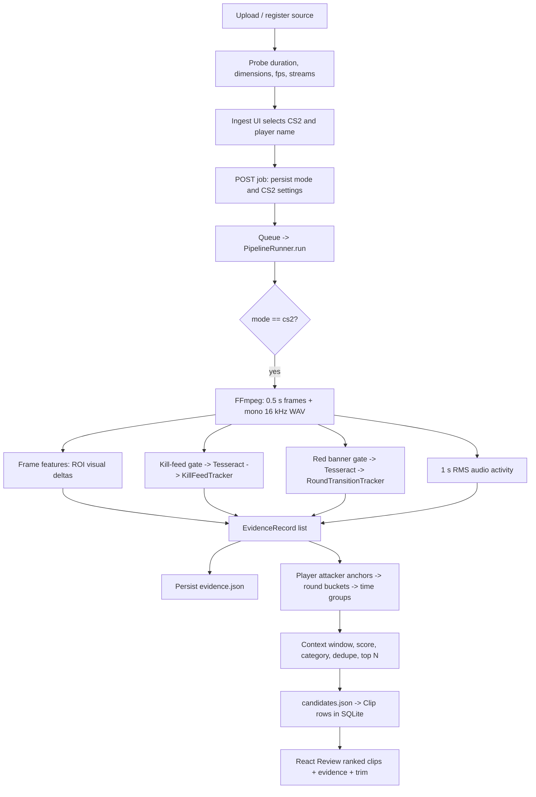

# AutoClip CS2 Highlight Detection: Technical Audit

**Scope and evidence standard.** This is a read-only audit of the checked-out source as inspected on 2026-11-22, plus existing tests, a checked-in annotation fixture, and pre-existing local cache files. The reports are the only files created for this task. Existing source changes in the working tree were present before the report was written and were not altered. “Code fact” means directly visible in source; “observed artifact” means read from a cached file; neither implies representative accuracy.

## Executive summary

The CS2 path is a deterministic local signal pipeline, not a gameplay-understanding model. It extracts a video frame every 0.5 seconds by default, scans fixed normalized HUD regions, calls local Tesseract only after pixel gates, confirms a row over two samples, heuristically splits its OCR words into two sides, and only anchors player-focused candidates on a confirmed attacker-side exact name match. Audio RMS and visual changes provide context/quality support, but cannot independently create a player-focused clip.

The highest-confidence cause of missed strong plays is this chain of strict gates: a kill-feed row must appear in sampled frames, pass dark-row and changed-ROI gates, OCR into a plausible line on at least two samples, split into attacker/victim text, match the exact selected name on the attacker side, and survive candidate grouping. Any failure drops the event as a player-highlight anchor; “possible” fuzzy identity matches are intentionally excluded. The OCR split uses the row’s overall text midpoint, not weapon-icon localization, and may include icon/assist artifacts in player names.

The checked-in fixture contains 12 manually annotated HUD events across three intervals of one 525.6-second, 1920×1080, 60-fps recording. It is not an evaluation harness and reports no detector output or confusion matrix. A pre-existing cached `player-phase-a-E04` run contains 148 evidence records, 16 records called kill-feed changes, 2 round banners, and one candidate. Of its kill-feed observations, 1 is attributed to the selected player as attacker, 13 are unrelated, and 2 unknown. In the annotated E04 excerpt, the selected player has two annotated deaths and one annotated kill; cache output captured one selected-player attacker event around 385.5 s and did not attribute the annotated deaths to the selected player. This is an illustrative narrow excerpt, not a score: cache metadata does not establish matching source revision/settings/ground truth coverage sufficiently to claim precision or recall.

## Architecture and execution order



### End-to-end path

1. `POST /api/sources/upload` streams 4 MiB chunks to a temporary file, calls `ingest_file`, then stores the returned `Source` (`backend/autoclip/api/sources.py:66-104`). `ingest_file` copies/moves the file into AutoClip’s media store and calls FFprobe via `ffmpeg.probe`; `Source` stores duration, width, height, fps, and audio/video flags (`backend/autoclip/pipeline/ingest.py:217-296`; `backend/autoclip/db/models.py:32-47`). Ingestion currently rejects sources without audio (`ingest.py:282-289`), including otherwise valid silent CS2 video.
2. The Ingest page initializes in CS2 mode and loads `autoclip.cs2.player_name` from local storage, defaulting to `thakurshaaab`; the UI requires nonempty input and submits it in settings (`frontend/src/pages/Ingest.tsx:22-40,109-135,222-227`). Workflow mode can be switched to transcript in Advanced Options (`Ingest.tsx:267-280`).
3. `JobSettingsIn` defaults to transcript at API schema level, while the frontend supplies CS2; `create_job` validates that CS2 has video, stores `mode` and serialized `CS2Settings` in `Job.settings`, and sets provider empty (`backend/autoclip/api/schemas.py:60-78`; `backend/autoclip/api/jobs.py:52-79`). `JobOut.of` returns the persisted player name (`schemas.py:81-118`). Name edits affect newly created job settings; there is no reanalysis-name-edit flow in this path.
4. `PipelineRunner.run` dispatches CS2 directly to `_stage_cs2_detection` and skips prepare, transcription, LLM highlights, reframe, captions, and export (`backend/autoclip/pipeline/runner.py:177-201`). It validates stored settings, calls `analyze`, stores ranked clip rows and writes runtime metrics (`runner.py:120-125,205-255`). If clips already exist, the CS2 stage returns them without running detection (`runner.py:209-212`).
5. `analyze` calls `extract_evidence`, persists evidence and candidates JSON, and adapts candidates into `Clip` rows (`backend/autoclip/pipeline/cs2/detector.py:33-91,94-125`). `EvidenceRecord` is an observation contract, not an asserted game event (`models.py:10-28`); `CS2Candidate` stores time range, category, confidence, quality, evidence IDs, and reason (`models.py:90-105`).

### Source/function map

| Stage | Source | Entry point / data |
|---|---|---|
| Upload and metadata | `backend/autoclip/api/sources.py`, `backend/autoclip/pipeline/ingest.py`, `backend/autoclip/pipeline/ffmpeg.py` | `upload_source` → `ingest_file` → `ffmpeg.probe` → `Source` |
| Mode and name | `frontend/src/pages/Ingest.tsx`, `backend/autoclip/api/jobs.py`, `backend/autoclip/api/schemas.py` | UI overrides → `create_job` → persisted `Job.settings.cs2.local_player_name` |
| Pipeline branch | `backend/autoclip/pipeline/runner.py` | `PipelineRunner.run` → `_stage_cs2_detection` |
| Sampling/cache/audio | `backend/autoclip/pipeline/cs2/sampling.py` | `extract_evidence`, `_build_evidence`, `_audio_evidence` |
| OCR/attribution/dedupe | `backend/autoclip/pipeline/cs2/recognition.py` | `read_lines`, `KillFeedTracker.observe`, `_split_kill_feed_row`, `_selected_player_role` |
| Round signals | `recognition.py`, `sampling.py` | `RoundTransitionTracker.observe`, `_has_round_banner_color` |
| Candidate formation | `backend/autoclip/pipeline/cs2/candidates.py` | `generate_candidates`, `group_evidence`, `_quality_score`, `deduplicate_candidates` |
| Persistence/API | `backend/autoclip/pipeline/cs2/detector.py`, `backend/autoclip/api/jobs.py`, `backend/autoclip/db/store.py` | JSON `evidence.json`/`candidates.json`; clips table; `/api/jobs/{id}/evidence` |
| Review | `frontend/src/pages/Review.tsx`, `frontend/src/api.ts`, `backend/autoclip/api/clips.py` | loads job/clips/evidence; preview, keep/discard, trim |

## Sampling, OCR, and audio implementation

### Video sampling and cost

`CS2Settings` defaults are `frame_interval_s=0.5`, `frame_width=1920`, `visual_change_threshold=0.12`, kill-feed ROI `(x=.70,y=.035,w=.295,h=.22)`, round ROI `(.30,.14,.40,.18)`, kill-feed ROI mean pixel change threshold `7.0`, round OCR interval `1.5 s`, and OCR enabled (`backend/autoclip/pipeline/cs2/models.py:49-79`). FFmpeg makes one pass, JPEG quality 5, scaling to at most 1920 px wide, and extracts mono 16 kHz signed PCM when audio exists (`sampling.py:106-129`). It does not sample at source 60 fps; a 0.5 s interval means 2 frames/s. Current frame timestamps are reconstructed as `index * frame_interval_s`, clamped to source duration (`sampling.py:145-157`).

Every decoded sample is converted to grayscale for ROI visual-difference calculation. Only configured regions (default full frame) are compared; mean absolute delta / 255 must reach 0.12 for a `visual_activity` record (`sampling.py:262-286,359-371`). This is activity, not a kill/action classifier.

### Kill-feed OCR

The default ROI is fixed in normalized frame coordinates, so it scales with resolution but does not detect HUD location, HUD scale, safe-area placement, or aspect-ratio-specific layout. At default 1920×1080 it covers about x=1344–1910 and y=38–275. It is not adaptive. `crop_region` maps normalized coordinates to pixels (`recognition.py:128-135`). Scaling the full source frame to a maximum 1920 width means larger source video can be downscaled before this ROI is cropped.

For each frame, the recognizer computes the kill ROI grayscale mean absolute difference from the previous sample; first sample is treated as change 255. OCR runs only if `_has_kill_feed_rows` sees at least five rows where more than 55% pixels are below grayscale 72, and ROI mean change is at least 7, unless the tracker has a pending row needing confirmation (`sampling.py:288-307,337-342`). Because the dark-band predicate is also a mandatory gate, unusual HUD brightness/background or a row that fails that simple geometry can prevent OCR entirely.

`read_lines` invokes local Tesseract as a subprocess (`stdin stdout --psm N tsv`) with an 8-second timeout. Kill rows use PSM 6 and scale 4.5; color crop is resized bicubically and converted to gray then Otsu binary threshold. Round banners also use PSM 6, but default scale 2.5 and no PSM-6 threshold branch if image is grayscale (`recognition.py:59-125`; `sampling.py:301-315`). Missing Tesseract, timeout, nonzero exit, or failed image encoding returns no lines. TSV tokens are grouped by block/paragraph/line; token confidence is clamped at zero and averaged per line. There is no kill-line minimum OCR confidence threshold.

`is_kill_feed_line` accepts text matching at least two `[a-z0-9_]` tokens of length ≥2 and total token characters ≥8, then rejects a row if any token exactly matches a hard-coded HUD exclusion list (`recognition.py:23-40,138-143`). It does not semantically establish that the line is a kill.

### Row parsing, rows, and persistence

The recognizer needs at least two positioned OCR words and image width. It sorts words by x, finds the midpoint of all recognized text bounds, assigns word centers left/right, and assumes left is killer and right victim. If selected name is found on a side, that side’s matched contiguous word sequence (up to four words) is used; other words on that side are otherwise joined into the name. Split confidence is always 0.75 if both sides have ≥2 normalized characters; no icon recognition/localization is done (`recognition.py:316-374`). This can absorb assist names, icon OCR debris, separators, or only part of a player label. There is no weapon-icon classifier or parsed weapon field: `weapon` and `is_headshot` are persisted as `None` (`recognition.py:205-234`). Headshot, wallbang, assist, and other icon indicators have no explicit handling.

Multiple lines in a crop are treated independently in one `observe` call. A pending line must match a subsequent OCR line within 1.5 seconds and have two observations before emission (`recognition.py:167-201,238-248`). At default sampling that normally means two neighboring 0.5 s samples, but OCR gating may skip either sample. Same-sample duplicate lines do not confirm themselves because pending matching is only added once per pass. New line starts at its first sample timestamp. Once emitted, similar active rows are suppressed for 8 seconds (`recognition.py:146-164,243-264`). Similarity threshold is 0.66; comparison uses ordered fuzzy token subsequence plus sequence similarity and ignores kill vocabulary (`recognition.py:471-503`). Distinct close victims can survive if at least two tokens differ enough; mistaken OCR similarity can merge different rows, and row changes can evade suppression.

No code adapts for kill feed rows that move vertically as more kills accrue beyond the fixed crop. Multi-row simultaneous feeds can yield more than one event when independently recognized and confirmed, but there is no explicit row identity, icon anchor, or event ordering reconstruction. One-frame-only entries, entries obscured before the next sample, entries outside the ROI, and entries not satisfying the dark/change gates are missed. OCR false recognition can create candidate “kill” records if the heuristic tokens and two-frame match pass.

### Round banner OCR

Round OCR is attempted only when the red-color gate passes in the fixed center region, and `current_time >= next_round_ocr_s`; the next eligible time is advanced by 1.5 seconds after an attempt (`sampling.py:309-320,344-356`). Red gate expects red HSV hues and broad banner-like row coverage. `RoundTransitionTracker` then requires normalized OCR text to contain `round` and one of `win/wins/won/victory`, with a 12-second cooldown (`recognition.py:267-302`). It detects winner-banner moments only. It does not identify round starts, round state, bomb plant/defuse, living-player counts, sides, or whether the selected player’s kill won the round.

### Audio

One-second windows of mono 16 kHz PCM are converted to RMS dBFS; windows ≥ −32 dBFS become `audio_activity` with intensity linearly scaled over 30 dB and confidence capped at 0.95 (`models.py:54-58`; `sampling.py:374-422`). This is loudness only: no speech recognition, gunshot classifier, crowd/voice detection, or event synchronization. Audio can support player-focused candidate quality if temporally nearby, but cannot create the selected-player candidate.

## Selected-player attribution rules

The player name is normalized with Unicode NFKC, removes Unicode format (`Cf`) characters, casefolds, and collapses whitespace (`recognition.py:309-314`). This is case-insensitive. A selected name and observed string match exactly after normalization, or exactly after removing whitespace. Otherwise punctuation/symbols are removed by Python `\w` compaction and a same-length compact equality can yield `possible`. Mapped OCR substitutions `0→o`, `1/|→l`, `5/$→s` yield `possible`; edit distance ≤1 is also possible only when both compact names are at least 8 characters. Possible matches receive 0.6 but are never “attacker” or “victim” (`recognition.py:377-429`).

Role attribution requires positioned words and split into sides. Exact selected name on left means attacker; exact on right means victim; exact on both or ambiguous possible on both gives unknown. Possible on one side returns `possible_attacker` or `possible_victim`; no match returns unrelated (`recognition.py:316-356,377-400`). Confirmed roles have confidence 1.0; possible role 0.6; unknown/unrelated 0.0. OCR confidence is recorded but does not gate exact attribution. Thus a low-confidence OCR string can still count if it exactly equals the selected name; conversely high OCR line confidence cannot rescue nonmatching identity.

For input `thakurshaaab`:

- `THAKURSHAAAB`, `Thakur Shaaab`, or surrounding spaces normalize/match as exact (case/space tolerance).
- `thakur5haaab` can become possible due `5→s`, and `thakurshaab` may be possible only if compact length is at least eight and one-edit away; either is excluded from player candidate anchors.
- `Notthakurshaaab` does not match by substring.
- `ThakurShaaab.` may compact to an equal name and be possible; punctuation itself is not a guaranteed exact match.
- Stylized Unicode compatibility characters can normalize under NFKC, but arbitrary lookalikes/confusables are not mapped. Accents/Unicode letters are casefolded in selected name; OCR token extraction only admits ASCII `[a-z0-9_]` in `normalize_text`, so non-ASCII player spelling can be lost before matching.
- If Tesseract omits/splits/spells a name differently, the row may be unknown/unrelated or only possible. Shortened in-game aliases are not accepted unless exact under normalization rules.

Every rejection path for a real selected-player kill: no decoded frame; feed event falls between 0.5 s samples or is visible for only one; downscaled/tiny/blurred HUD; kill-feed row outside fixed ROI; dark-band test fails; ROI difference <7 with no pending row; OCR returns no valid line or row fails text heuristic; OCR row only one observation or second sample more than 1.5 s later; similarity mismatch; row split lacks positioned words or one side; overall-midpoint split puts target on wrong side or joins debris into observed name; exact/allowed match fails or target is only `possible_attacker`; attacker/victim direction is reversed due layout/parser; selected role not attacker; role confidence <0.9; group later separated by boundary or >8 s gap; candidate suppressed by >0.5 interval IoU; candidate falls after top-20 quality truncation. In addition, candidate generation returns existing clips without reanalysis when clips already exist. Changing input name only affects a newly configured job; no in-place reanalysis switch is exposed.

## Candidate generation, grouping, score, and timing

### Anchor and grouping logic

When `local_player_name.strip()` is truthy, anchors are only `kill_feed_change` records with `selected_player_role == "attacker"` and attribution confidence ≥0.9 (`backend/autoclip/pipeline/cs2/candidates.py:65-86`). No kill confidence threshold is applied. Audio, visual changes, round transitions, and deaths cannot generate a player-focused candidate alone. In non-player-focused mode, kill feed, round transition, voice reaction, and speech moment types can anchor, though current sampling produces no voice/speech events.

Round ends are all round-transition events confidence ≥0.7. `bisect_left(round_ends, kill_time)` assigns each selected kill to a round bucket; within each bucket records are grouped when their start is no more than `merge_gap_s` (default 8 s) after the current group end (`candidates.py:87-110`; `group_evidence` at 36-62). Grouping does not use a multi-kill fast window separate from this general 8-second merge. A missed banner means different rounds can share a bucket/group; detected banners split the buckets. Same-round kills >8 seconds apart are separated. A kill exactly at a boundary is assigned to the earlier bucket because `bisect_left` is used.

There is no living-player count or one-versus-N state, so clutch logic is absent in the implementation. “Ace” is a label heuristic: at least 5 kill feed records in the group, a detected upper round bound, all victim names nonempty and distinct (casefolded), and every record confidence ≥0.7 (`candidates.py:151-171`). It does not establish that events are all genuine kills beyond the OCR heuristic, that all are same-round except via bucket, or that selected player killed all opponents except via anchors. Three kills only get `player_triple_kill_potential` if group is round-bounded; without detected boundary they are `player_multi_kill_sequence_potential` (`candidates.py:248-286`). Four kills get `player_four_kill_round_potential` only with boundary; otherwise generic multi-kill. A round-end banner can be missed or falsely detected, changing categories and clip boundaries.

### Candidate timing

Candidate starts at `max(round_lower_bound, group.start - context_before_s)` and ends at `min(round_upper_bound, group.end + context_after_s)` (defaults 6 s before / 10 s after). Duration is clamped toward `[15,60]` seconds; if shorter than 15, `_expand_interval` spreads extra duration within round/source bounds. `normalize_interval` clamps into `[0,source_duration]` and rounds to milliseconds (`candidates.py:25-33,114-128,195-204`). Candidate does not model kill animation, setup, or round outcome beyond a detected banner bound. It can start after long setup, and end at the round transition (often appropriate but not guaranteed); missed boundaries can allow clip to span round change. A small recording edge or short round can produce a clip shorter than minimum because no room is available. Default post context may truncate a round-winning moment occurring more than ten seconds later; round boundary clamping cuts exactly at the detected banner timestamp.

Candidates are deduplicated by descending quality; an interval with IoU >0.5 against already-kept candidate is dropped, then sorted quality-descending/start ascending and capped at 20 (`candidates.py:192,207-222`; settings lines 73-79). This can merge overlapping event groups in the review selection sense by deleting one, but there is no candidate interval union or explicit splitting. Multi-kills can become separate clips when group gap exceeds 8 s or detected round boundary separates them; close separate action may be grouped together.

Manual trim is a review-time patch to a clip’s start/end, sets `user_trimmed`, and updates transcript word indices if transcript exists. For CS2 with no transcript indices stay zero (`backend/autoclip/api/clips.py:110-154`). It does not change the underlying evidence/candidate JSON or trigger detection.

### Exact ranking formulas

`_quality_score(records,kinds)` counts `kill_feed_change` records, takes the maximum `intensity` metadata value over all evidence (default 0), and computes:

```text
event_bonus   = min(48, max(0, kill_count - 1) * 12)
support_bonus = min(12, max(0, number_of_distinct_evidence_types - 1) * 4)
quality       = clamp(20 + event_bonus + support_bonus + round(12 * clamp(intensity,0,1)), 0, 85)
```

This rewards additional kill records and evidence types; ordinary OCR kill evidence has no intensity, so a single-kill candidate with only that type scores 20. Audio intensity may add up to 12; a second/third evidence type adds 4 each, max 12. Scores are capped 85, not 100, despite UI denominator `/100` (`candidates.py:235-245`; `Review.tsx:266-280`).

Detection confidence is distinct: for each distinct evidence type, take its maximum detection confidence; average those maxima and cap at 0.99 (`candidates.py:225-232`). In player mode only group anchor kill records contribute to candidate confidence; contextual audio/visual cannot inflate player attribution confidence (`candidates.py:145-150`).

Candidate generation signals: only confirmed selected attacker kills in player mode; other signals can only support quality/confidence of candidate where included. In unselected mode, configured anchor evidence types can create candidates. There is no minimum quality threshold; ranking is order by quality after dedupe and max-count truncation.

## Feature support matrix

| Feature | Status | Verified implementation |
|---|---|---|
| Single kill | Partial | OCR row event; player mode candidate only exact attacker role |
| Double kill | Partial | 2 kill records in one ≤8 s group; same selected attacker anchors required in player mode |
| Triple kill | Partial | 3 records labeled triple only with detected round bound |
| Quad kill | Partial | 4 records labeled four-kill only with detected round bound |
| Ace | Partial/inferred | 5+ distinct victim strings, confidence ≥.7, detected round end; not a scoreboard/player-count proof |
| 1v2/1v3/1v4/1v5 clutch | Not implemented | no alive-player state or clutch parsing |
| Round-winning kill | Not implemented | winner banner is context; no correlation to winning killer |
| Opening kill | Not implemented | no round-start model |
| Headshot | Not implemented | field always null |
| Wallbang/no-scope | Not implemented | no indicator/icon handling |
| Assists | Not implemented | may contaminate text-side parsing; not represented as roles |
| Flick/spray transfer | Not implemented | no per-frame action/player-view analysis |
| Consecutive/fast kills | Partial | generic 8-second grouping; no speed-specific feature or bonus |
| Low HP | Not implemented | no health HUD OCR |
| Eco/full-buy/weapon difficulty | Not implemented | no economy/loadout/weapon parsing |
| Bomb plant/defuse | Not implemented | no event parsing |
| Important round outcome | Partial | winner banner event and boundary only, no outcome value or selected-player link |
| Audio reaction/action | Not implemented in current extractor | RMS only; types exist in candidate vocabulary but no generation code |

## Evidence, review, and evaluation

The detector writes `cs2/evidence.json`, `candidates.json`, `features.json`, sample JPEGs, and `metrics.json` under job work cache. `/api/jobs/{job_id}/evidence` returns evidence JSON (`backend/autoclip/api/jobs.py:173-189`). Candidate clips carry evidence IDs, category, confidence, quality score, and reason (`detector.py:94-110`). The Review page fetches job, clips, styles, and evidence; ranks clips as returned, defaults to the first, shows player focus, category, confidence, quality, evidence explanations, preview, keep/discard, and trim (`frontend/src/pages/Review.tsx:36-56,147-157,179-181,200-249,256-284`). It displays “Potential” for CS2. The clip list order is established by generated quality ranking and rank assignment in runner (`runner.py:227-229`).

### Evaluation evidence actually present

- `tests/fixtures/cs2_ground_truth_E04_f2nCTnE.json`: one recording, duration 525.6 s, resolution 1920×1080, 60 fps; manually reviewed intervals `[320,348]`, `[380,410]`, `[428,448]`; 12 listed events (10 kill-feed-change, 2 round banners). Two selected-player deaths are listed at 324 and 432; one selected-player kill at 385. The fixture says ±1 s tolerance and records a correction of two timestamp annotations. There is no checked-in evaluator comparing detector output to these labels.
- Tests `tests/test_cs2.py` and `tests/test_cs2_recognition.py` cover deterministic logic and generated non-gameplay media; they do not establish gameplay OCR accuracy or quality. The test module itself labels evidence tests as generated non-gameplay (`test_cs2.py:1`). No ground-truth metric computation appears in repository search.
- README explicitly says “whether the clip picks are good” is unverified (`README.md:193-203`). The general real-footage verification is about the talking-head export pipeline, not CS2 picks.
- Cached `player-phase-a-E04/cs2/evidence.json` (pre-existing local artifact) has 148 observations, including 16 kill-feed records and two round-transition records; one candidate from 379.5–395.5 s with one selected-player attacker anchor around 385.5 s. The annotation fixture lists selected-player kill at 385 and deaths at 324/432. The cached evidence did not attribute the annotated deaths to the target; detector has no false-negative score because fixture coverage and cache provenance/revision are not controlled. It did recover the annotated selected-player kill within the tolerance. This artifact is concrete evidence of OCR/role parsing difficulty, not a measured accuracy claim.
- Other pre-existing cache folders include results with detector versions `cs2-events-4` and `cs2-events-6`, no matching checked-in labels, and differing settings such as empty selected player. They must not be pooled as an evaluation set. Cached metrics provide runtime/frame/OCR/candidate counts, not TP/FP/FN.

Therefore: confirmed number of annotated recordings = 1; listed manual HUD events = 12. Selected-player events in listed annotations = 3 (one attacker kill, two deaths). TP/FP/FN, precision, and recall are **not established**. No independent multi-kill, ace, or clutch evaluation is present. The fixture is also likely a tuning artifact (filename and cached `player-phase-a` suggest development phase); no documented train/tune holdout can be verified.

## Root-cause analysis

### A. Confirmed implementation limitations

1. **Sparse sampling and confirmation.** Two frames per second plus two-sample confirmation rejects short-lived rows and timestamps events only at first sampled visibility (high impact; high confidence). OCR gating can skip samples. CPU: deliberate savings; accuracy: reduced for transient events.
2. **Fixed ROI and pixel gates.** One hard-coded normalized kill-feed location plus dark-band/change thresholds can suppress OCR entirely across HUD positions/scales/themes (high; high). Normalized scaling helps dimensions only; it is not HUD adaptation.
3. **Fragile row parse.** Attacker/victim split uses text bounding-box midpoint, not kill icon detection; no minimum OCR confidence, no confidence calibration, no weapon/headshot semantics (high; high). OCR lines may include assist and icon artifacts.
4. **Strict attacker-only exact candidate gate.** Possible fuzzy names, victim roles, unknown parsing, and unrelated OCR never anchor selected-player candidate (high; high). This avoids false positives but makes recall fragile.
5. **Round boundaries are sparse banner events, not round-state tracking.** Missed banner prevents reliable round grouping/category and can mix events; false or delayed banner can divide/clip them (medium-high; high).
6. **Score rewards counts/context, not play quality.** No contextual combat understanding; single confirmed kill receives low fixed quality, whereas multiple noisy rows and activity may rank higher (medium; high).
7. **Ingestion requires audio.** CS2 video-only upload is rejected despite detector handling optional audio (`ingest.py:282-289`, sampling optional path); this is an availability limitation, not direct highlight recall for accepted videos.

### B. Evidence-supported suspected causes

1. **OCR quality/segmentation is likely a major observed failure mode.** Cached E04 observations show noisy OCR strings and false side parsing; one annotated target kill recovered. The single cache cannot establish rate, but directly exhibits name corruption and role parsing artifacts (high confidence as a cause in this sample; medium confidence as general impact).
2. **Two-hit row confirmation combined with 0.5 s sampling likely rejects short row appearances** (mechanism confirmed; number of missed real kills unknown).
3. **Round detections can be too late/absent for triple/quad labels.** Round detector runs only on red-gated banners then needs text terms; actual recall unmeasured.
4. **Name matching may not support HUD aliases.** Exact or narrowly fuzzy normalized match cannot reconcile deliberate shortened names (mechanism confirmed; actual use of aliases unknown).

### C. Hypotheses requiring more footage

- How often current CS2 HUD positions, size, opacity, stream overlays, kill-feed fades, ultrawide capture, spectator HUD, or localization fall outside assumptions.
- Whether downsampling creates most misses versus Tesseract name/split errors.
- Whether candidate groups often merge distinct plays or split genuine multi-kills under real timing distributions.
- Whether map/weapon, low-health clutch, or audio reaction cues improve subjective highlight value enough to justify additional extraction.

### Prioritized opportunities (proposal only; no code changed)

| Priority / proposal | Problem and expected benefit | Cost / complexity | False-positive risk | Validation |
|---|---|---|---|---|
| 1. Build a labeled, clip-level CS2 evaluation set first | Establish per-stage recall, attribution precision, candidate recall, boundary error; prevents intuition-led tuning | Low CPU; moderate annotation/tooling effort | None from evaluation itself | Multiple recordings, held-out sessions, timestamped kills and roles, independent adjudication |
| 2. Preserve row crops and OCR alternatives in debug evidence | Makes failures diagnosable; tune thresholds based on actual misses | Low/moderate storage; low-medium complexity | None directly | Compare stored OCR crops/text with labels across HUDs |
| 3. Add adaptive/denser sampling around changed kill ROI | Capture transient feed rows without full-rate OCR | Moderate decode/OCR increase; medium complexity | Some duplicated/false observations if temporal confirmation loosened | Measure added TP and FP per extra OCR second on fixed labeled set |
| 4. Replace midpoint split with spatial/icon-aware row segmentation and multi-hypothesis names | Improve attacker/victim and name extraction, especially with assists/icons | CPU low/moderate; complexity medium | Medium if ambiguity is promoted | Role confusion matrix and exact selected-player attribution precision/recall |
| 5. Use configurable/auto-detected HUD profiles and ROI calibration | Support scale, aspect ratio, HUD offsets, capture overlays | Low runtime after setup; medium complexity | Medium if auto-ROI sees incidental text | Resolution/HUD matrix, annotation of ROI coverage and false OCR triggers |
| 6. Separate kill detection from identity; retain uncertain candidate evidence for review | Recover possible target events while preserving an uncertainty label | Small CPU; medium product/UX complexity | Higher if uncertain events become ranked clips | Plot recall/precision across confidence thresholds; human review burden |
| 7. Track round state and kill sequences explicitly | Better triple/quad/ace and cross-round separation; eventual clutch groundwork | Low/moderate CPU; higher logic complexity | Medium when banner or event sequence misclassified | Per-round sequence matching and boundary error on labeled full matches |
| 8. Score with transparent, validated factors | Rank fast multi-kills and round outcomes above generic loud/activity windows | Low CPU; medium annotation/analysis work | Depends on factor quality | Blind human preference ratings on held-out candidate pairs |
| 9. Keep optional audio cues lightweight and local | Gunshot/voice excitement cues could augment ranking, not identity | Moderate CPU if simple spectral features; model-free possible | Medium in noisy comms/music | Ablation against video-only, subjective ratings and event labels |

Avoid heavy vision-language or game-state AI until the evaluation set shows that local OCR/spatiotemporal improvements cannot meet the needed recall/cost target.

## Questions needing additional evidence

1. Which exact recordings and job IDs correspond to the user’s perceived missed highlights, and can those local source files be used for a labeled evaluation?
2. Is the selected HUD name exactly the scoreboard/kill-feed spelling for each recording, or is there an alias/shortened form?
3. Which CS2 HUD scales, resolutions/aspect ratios, spectator/player views, and overlays must be supported?
4. What does “best highlight” prioritize: kill count/speed, round importance, clutch survival, aim quality, or viewer reaction?
5. Is the pre-existing cache run `player-phase-a-E04` from the same source and settings as the checked-in fixture? It appears aligned by timestamps but its source/cache provenance and revision are not independently established.
6. Can a future evaluation include both high-action and ordinary rounds, several players/names, varied HUD settings, and held-out recordings?

## Key source references

Line references above point to the repository state inspected for this audit. Core implementation files: `backend/autoclip/pipeline/cs2/{models.py,sampling.py,recognition.py,candidates.py,detector.py}`; orchestration `backend/autoclip/pipeline/runner.py`; upload/API `backend/autoclip/{api/sources.py,api/jobs.py,api/schemas.py,pipeline/ingest.py}`; review `frontend/src/pages/{Ingest.tsx,Review.tsx}`. Tests/fixture: `tests/test_cs2.py`, `tests/test_cs2_recognition.py`, `tests/fixtures/cs2_ground_truth_E04_f2nCTnE.json`.
