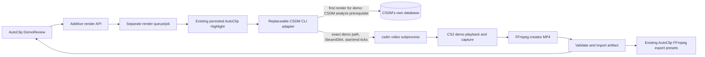

# AutoClip + CSDM Integration Roadmap

**Proposal only.** Do not implement the adapter until a separately approved CSDM Windows standalone render has passed the content and cleanup checks in [04_csdm_windows_poc.md](04_csdm_windows_poc.md).

## Target architecture

AutoClip is installed and run on the same Windows PC as CS2 and CSDM for the first integration. Do not introduce a remote worker or distributed services. AutoClip’s detector creates and persists the highlight; a replaceable subprocess adapter submits only the selected interval to CSDM; the returned MP4 enters AutoClip’s existing local review/export flow.



CSDM’s analyzer is only an input prerequisite for its CLI player-slot/camera lookup. AutoClip remains authoritative for selected player, highlight identity, tags, score, event evidence, and start/end tick bounds. CSDM’s `--mode player` must not be used for this integration because it generates its own intervals around events.

## Existing AutoClip components to preserve

| Existing component | Current source | Integration rule |
|---|---|---|
| Demo record/identity | `backend/autoclip/db/models.py`: `DemoFile`; `backend/autoclip/api/demos.py` | Resolve the managed `.dem`, content hash and persisted player/highlight. Do not use browser-provided path or name as identity. |
| Normalized cache/parser | `backend/autoclip/cs2demo/adapter.py`, `cache.py`, `models.py` | No parser changes. Hash-check the same demo bytes passed to CSDM. |
| Highlight data | `backend/autoclip/cs2demo/detection_models.py`: frozen `Highlight`; `analyze.py`/`scoring.py` | Treat `highlight_id`, `player_id`, ticks, tags, score and evidence as immutable render inputs/provenance. Never recompute or normalize them in the adapter. |
| Parse background queue | `backend/autoclip/cs2demo/queue.py` | Keep it dedicated to validation and parsing. Do not enqueue a long CS2 session into it. |
| Existing general job queue | `backend/autoclip/jobs/queue.py`, `pipeline/runner.py` | Existing video jobs are not demo-render jobs. Do not pretend a demo analysis is an ordinary uploaded source. |
| SQLite and paths | `backend/autoclip/db/schema.py`, `db/store.py`, `paths.py` | Additive render-job/artifact persistence only after POC; on Windows start with fresh data root because Mac absolute paths are not portable. Do not migrate the Mac database as part of renderer work. |
| Demo review UI | `frontend/src/pages/DemoReview.tsx` | Later add Generate Video/status/preview on the selected highlight. Preserve current analysis behavior. |
| Existing exports | `backend/autoclip/pipeline/export.py`, `backend/autoclip/api/clips.py` | Import horizontal MP4 as a source/artifact then bridge to the current export path. Do not change or duplicate existing presets. |

No existing application source is changed by these reports. Exact paths should be re-inspected at implementation time because the working tree is currently uncommitted.

## Proposed minimal contracts

Design-level contract only; names are illustrative until implementation approval.

```text
RenderRequest:
  request_id                # idempotency key for this attempt
  demo_id, demo_sha256      # resolve inside AutoClip managed store
  highlight_id              # existing stored candidate; do not select one here
  player_id                 # AutoClip key: steamid:<decimal SteamID64>
  steamid64                 # CSDM --focus-player argument
  original_start_tick       # exact Highlight.start_tick
  original_end_tick         # exact Highlight.end_tick
  render_start_tick         # equals source start unless separately approved context
  render_end_tick           # equals source end unless separately approved context
  preset_id                 # allowlisted fixed settings, never arbitrary CLI args

RenderResult:
  job_id, status, phase, csdm_version
  demo_sha256, highlight_id, player_id, requested_ticks
  artifact_path/id, sha256, bytes
  ffprobe metadata (duration, width, height, FPS, codecs, audio stream)
  exit_code, bounded logs, warnings, actionable error code
```

The first preset should match the validated POC: CS recording system + FFmpeg, 1920×1080 at 60 fps, full HUD, game audio, H.264/AAC in MP4, explicit FFmpeg path, output beneath a job-specific folder, close game when complete. Do not expose an arbitrary `--cfg`, encoder string, output directory, or process option to the frontend. If extra event context is later requested, represent render-only bounds separately from the unchanged AutoClip highlight bounds and cite the source round-end tick/evidence; never assume tick/64.

## Minimal backend execution flow

1. User selects **Generate video** on a particular existing highlight. API validates that highlight belongs to selected demo/player and that demo file exists and its SHA-256 matches.
2. Create a render job separate from parse and general video jobs. Snapshot immutable highlight ID, event provenance, player SteamID, source ticks, selected preset and demo hash.
3. Ensure CSDM CLI is installed and version-allowed, FFmpeg path is verified, output/temp disk is sufficient, CS2 is available, and no conflicting render is running. Fail before launching CS2 if CSDM or required files are absent.
4. Ensure CSDM has analyzed the exact demo. The first POC can run `csdm analyze <demo> --source faceit --json`; production behavior should call the CLI only when necessary or tolerate the CLI’s skip-existing response. Check CSDM analysis output and player lookup for the target SteamID. This mutates CSDM’s database only; never use its analysis to replace AutoClip events. Persist only CSDM version/preparation status in AutoClip if later needed.
5. Build a fixed argument array and launch `csdm video <demo> <start> <end> ...` with `shell=False`, UTF-8 log capture, a per-job output directory and controlled environment. Never interpolate user input into a shell string. One CS2/CSDM video job at a time.
6. Report coarse phases (preflight, CSDM prepare, queued/recording, output validation, import, complete). CSDM prints statuses and elapsed time but does not document stable percentage progress. Store logs as bounded per-job diagnostics.
7. On success, recursively locate exactly one new MP4 beneath CSDM’s unique video-ID folder. Validate hash/nonzero bytes, FFprobe streams, dimensions/FPS/duration, and full decode; copy/import to AutoClip’s managed artifact directory and verify copied hash.
8. Display the returned MP4 in the existing review workflow. User reviews the recording, then AutoClip may route it through the existing FFmpeg export presets.

### Cancellation and process control

CSDM documents Ctrl+C cancellation and the CLI blocks until its video completes. Its source implements an abort routine that kills related game/HLAE/FFmpeg processes, waits for file handles to release, cleans temporary files and uninstalls the CSDM plugin. Windows process-group signaling through Python needs a target-PC test; do not assume `Popen.kill()` provides safe cancellation. The integration should first prove that a console control event reaches CSDM and that cancellation closes CS2 and restores plugin/config state. If that cannot be guaranteed, keep cancellation disabled in the first UI release and show a clear wait/recovery path rather than hard-killing.

## Data and database handling

- Use a fresh Windows `AUTOCLIP_HOME` for the initial CSDM experiment. Do not open a copy of the Mac DB with stale absolute paths.
- Let AutoClip retain its parsed normalized cache, player identity and highlight JSON. CSDM uses its own DB for renderer lookup; do not merge/copy databases or write CSDM rows into AutoClip.
- CSDM analysis is a prerequisite, not an additional AutoClip detection stage. A CSDM parse failure means **render unavailable**, not “remove/reclassify the AutoClip highlight.”
- Persist a render-job row and a rendered-artifact row with foreign references (demo ID/hash/highlight ID/player) and request/result provenance. Avoid copying the normalized event corpus into those rows.
- Keep CSDM raw frames/audio only in CSDM’s work/install area. Import the final MP4 only after validation. Retain logs/error evidence by policy; clean stale raw/temp files only after the game process exits and hashes/logs have been captured.
- Never mutate original AutoClip demo paths, demo records, highlight fields, or existing user exports.

## Testing plan after approval

### Adapter contract tests (fake executable; no CS2)

- Correct fixed argv with paths containing spaces; `shell=False`.
- Exact demo/hash/player/tick binding and no re-analysis/re-scoring.
- Refuse mismatched demo hash, stale/missing highlight, absent file, missing CSDM/FFmpeg, low disk, invalid interval, CSDM roster miss.
- Nonzero exit, exit 2 usage error, timeout, cancellation, empty/ambiguous output, missing audio, corrupt MP4, multiple MP4s and interrupted import.
- Job lifecycle persistence/restart behavior, bounded logs, unique attempt output, safe cleanup and retry.

### Windows integration test (real demo; separately approved)

- Use the ThakurShaaab round-15 case; verify CSDM’s Windows analysis resolves the same SHA and SteamID.
- Verify both kills and the transition in actual first-person footage; check HUD, audio, stream metadata and frame decode.
- Compare visual review of same request on two runs; verify `CS2` close and plugin/config restoration.
- Measure total time, space use (including game install volume), temporary frame throughput, CPU/GPU, output size and repeatability.
- Negative cases: invalid SteamID, wrong/missing CSDM analysis, unwritable output folder, insufficient temp disk, interrupted render, game crash, missing audio and CSDM version update.

Do not claim render accuracy from the fake adapter tests, CLI exit code, AutoClip event JSON, or FFprobe alone.

## Phased roadmap and gates

| Phase | Work | Gate / exit criteria |
|---|---|---|
| 0. CLI capability | On Windows, verify `csdm --version`, `csdm video --help`, `csdm analyze --help`, actual executable paths, FFmpeg support, CS2 path and disk. | Installed help confirms every required documented flag; no automatic downloads; no DB writes in this phase. |
| 1. Standalone render | Separately approve CSDM analysis DB write, then generate one MP4 from exact AutoClip ticks/SteamID. | All strict visual/audio/metadata/restoration criteria in the POC report pass twice. |
| 2. Adapter/job API | Add replaceable subprocess adapter, additive render-job/artifact persistence and coarse progress. | Windows contract/API tests pass; one selected highlight produces linked artifact; detector unchanged. |
| 3. Review UI | Generate one/selected, progress, retry/cancel (only when safe), preview and download. | UI shows provenance/error and all existing demo review remains unchanged. |
| 4. Batching | Sequential multi-highlight queue, one CS2/CSDM job at a time; optimize only after single-clip reliability. | No cross-highlight state leakage; failed clip does not lose prior artifacts; cap disk usage. |
| 5. Existing Shorts exports | Bridge returned horizontal MP4s into existing exporter. | Existing presets/regression tests pass unchanged; no duplicate encoding. |

## Rollback/compatibility rules

- Pin and record CSDM version, CS2 build, game plugin version, FFmpeg version and output preset per render.
- On CSDM/CS2 update, disable rendering until Stage A and one smoke POC pass again. Do not change detector state to work around renderer incompatibility.
- Make the adapter feature opt-in and removable; AutoClip analysis and existing exports must work when CSDM is not installed or disabled.
- Preserve the original Mac data untouched. For Windows, restore the clean pre-POC CSDM install/config snapshot and use the fresh Windows AutoClip data root if the POC fails.
- Never automatically switch to HLAE, alternate POV, generated event sequences, modified score/ticks, or an online CS2 session after a failure.

## Decision

CSDM merits a standalone Windows test because its tick-range, SteamID-focus, audio, and video options map closely to the existing highlight object. It is **not yet approved as AutoClip’s backend**. The test must first establish demo preparation, real POV correctness, exact event visibility, synchronized audio, output collection and safe restoration on the user’s Windows install. Only then should the replaceable adapter be implemented.
